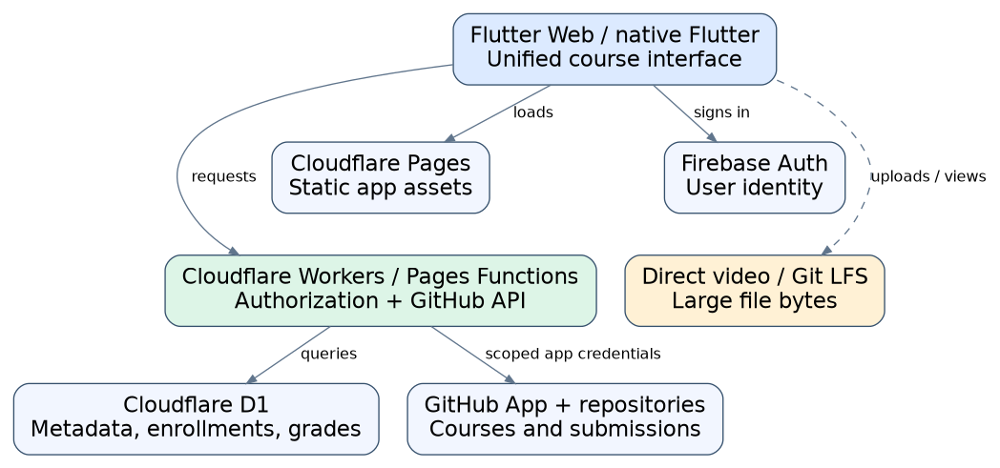
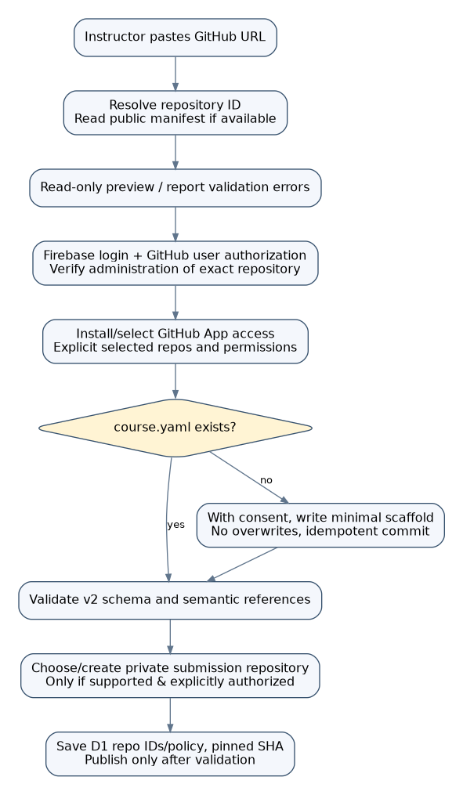
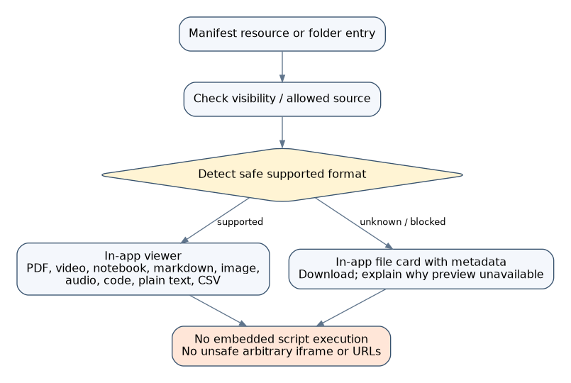
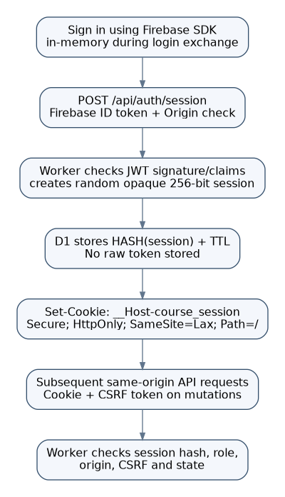
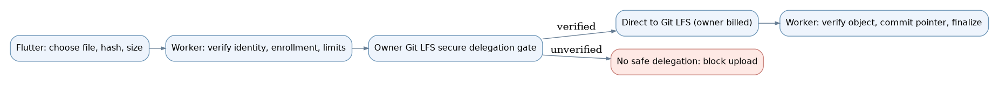
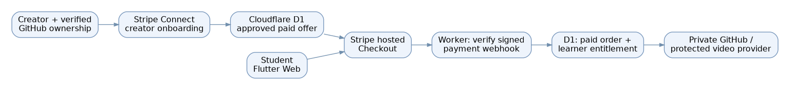
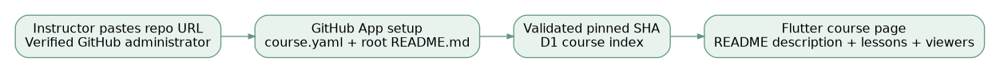
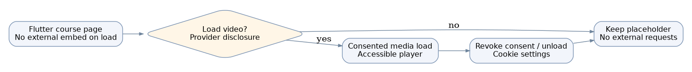
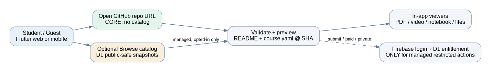
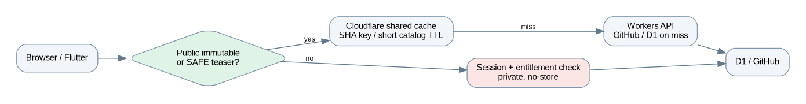

% Portable Course Platform — Implementation Requirements v4.0
% Architecture and repository contract
% 21 November 2026

# Portable Course Platform — Technical Requirements Specification v4.0

**Status:** final proposed implementation baseline for an AI coding agent; operated and approved by one human owner, with required functional/security verification and documented legal self-review (not a mandatory outside-counsel sign-off).  **Audience:** Codex, Claude Code, maintainers, instructors and reviewers.  **Font:** 14-point body text in the supplied Word/PDF deliverables.

**Normative v4.0 sources:** This document, `docs/IMPLEMENTATION_DECISIONS.md`, `docs/CORE_EXPERIENCE_AND_CATALOG.md`, `docs/CACHING_PERFORMANCE_COST.md`, `docs/COST_MODEL_FINAL.md`, `docs/RELEASE_TESTS_V4.md`, `db/0004_catalog_discovery.sql`, `schemas/*-v3.schema.json` and `schemas/grading-result-v1.schema.json` JSON Schema Draft 2020-12, `docs/SEMANTIC_VALIDATION.md`, `docs/SESSION_SECURITY.md`, `docs/RENDERING_REQUIREMENTS.md`, `db/0001_init.sql` plus `db/0002_commerce_autograding.sql`, `docs/COMMERCE_AND_ACCESS.md`, `docs/AUTOMATIC_GRADING.md`, `docs/COMMERCE_COSTS.md`, `docs/README_COURSE_DESCRIPTION.md`, `docs/EU_PRIVACY_COOKIES.md`, `docs/WCAG_ACCESSIBILITY.md`, `docs/EU_MARKETPLACE_COMPLIANCE.md`, `docs/SOLO_OPERATOR_GITHUB_POLICY.md`, `docs/ERROR_FAILURE_SEMANTICS.md`, `db/0003_compliance.sql`, `docs/COMPLIANCE_API.md`, and `api/openapi.yaml`. The packaged files are collectively normative. Under conflict: security invariants > v3 schema and semantic rules > API/session/rendering docs > non-normative templates and archived material. **Never generate a v1 course**.

**Product priority:** Opening a valid public GitHub repository by URL is the primary workflow, requiring no catalog registration. An optional, opt-in course catalog uses only D1 and Workers and never blocks the link-based experience. All shared caching obeys privacy classifications in `docs/CACHING_PERFORMANCE_COST.md`.

**Design decision:** Flutter Web and native Flutter deliver an integrated course interface. Cloudflare Pages handles static web hosting, same-origin Workers/Pages Functions handle minimal APIs and authorization, D1 stores metadata, Firebase Auth handles identities, GitHub holds instructor-controlled course files, and video providers stream recordings. GitHub LFS is the sole supported large-submission storage provider. Direct client upload remains disabled until an end-to-end delegated-authorization security test succeeds; if it fails, affected large uploads must be blocked, not routed through another storage provider or granted repository tokens.

**Explicit scope:** PDF notes and assignment instructions; lecture recordings embedded in-app; supplementary arbitrary files/folders; `.ipynb` files statically previewed (not executed); format-agnostic submissions; **manual, optional automatic, or hybrid grading**; optional verified certificates and **free or one-time paid courses with a 5% platform commission**. Not in scope: browser-side notebook execution, prerequisites, quizzes, live meetings, dedicated video hosting, recurring billing, or untrusted-code execution in Cloudflare Workers.

---

# 1. Vision and scope (approved product concept)

The platform is a lightweight, GitHub-backed course publishing and learning interface. The DEFAULT entry point is a GitHub repository URL, not a marketplace listing; a catalog is optionally provided through D1 for instructors who explicitly opt in. An instructor links an existing GitHub repository, authorizes a GitHub App, and receives an initialized, validated course structure. The course manifest tells Flutter Web/mobile which lectures exist, their order, where each PDF or notebook is located, and which external video URL belongs to each lecture. Students do not need to interact with raw GitHub repositories for ordinary reading, watching or submission.

Core user experience: instructors publish lecture recordings (external video provider), PDF notes, additional files and assignment instructions; students open those resources inside the platform where technically supported, submit arbitrary permitted files and receive an instructor-issued manual grade or a verified optional automatic/hybrid grade. The application may issue verifiable certificates bearing a learner's self-reported legal name. No in-browser notebook execution, advanced quizzes, prerequisite engines, or custom video streaming is required. Automated grading is optional and executes only in owner-approved GitHub Actions workflows, never in the platform's Workers.

-   Course source ownership: instructors retain control of their content repository and of the private submissions repository; the application stores only metadata, identity, authorization state, grades/certificates and opaque file references in its own database.

-   Portability: the versioned course.yaml file and linked assets define portable instructional content. A platform-specific registration is needed only for enrollment, private content, submission authorization, optional catalog listing, paid sales and certification.

-   Open discovery: any public repository containing a valid course.yaml can be previewed or added by URL without requiring its author to register; only a verified GitHub repository administrator may claim it as an instructor-managed course.

-   Closed access: repository privacy and platform enrollment are independent. D1 is authoritative for enrollment policy and lecturer/assistant permissions; no YAML file may grant itself privileges.

-   **Root README contract:** `README.md` is mandatory for published courses and is rendered inside Flutter as the full course description (not sent to GitHub for routine viewing). `course.yaml` is the machine-readable lecture/assignment outline; its short `course.summary` is only a public-safe catalog teaser. The README and manifest are loaded from one pinned commit. For paid/private repos, unauthorized visitors see only a safe public teaser, not the private README.

## 1.1 Primary actors and workflows

-   Instructor: paste existing GitHub repository URL; view a public preview; sign into the platform; connect/install the GitHub App on selected repositories; prove administrative control; request automatic scaffolding; optionally configure restricted enrollment, submission limits and an independent private submissions repository.

-   Platform: resolve URL to a stable GitHub repository ID; validate or initialize course.yaml; establish immutable course ID and default branch; persist verified mappings in D1; sync manifest changes through GitHub webhooks or explicit refresh; never store personal access tokens in D1 or reveal installation tokens to clients.

-   Student: follow a public course URL; register using Firebase Auth if enrollment/submission is required; watch linked lectures and read notes in the frontend; upload permitted files using a scoped direct-upload mechanism; view only their own submissions and grades.

-   Lecturer/assistant: inspect submission records, open private files through an authorized retrieval flow, assign numeric scores and comments, issue/revoke certificates within their permissions. Grade status and certificate validity remain authoritative in D1.

## 1.2 Instructor workflow

The user supplies a repository URL, not a personal access token. A public repository can be viewed immediately; managed setup requires a GitHub App installation with selected-repository access and a verified right to administer the target repository. Installing the App does not by itself authorize creating arbitrary repositories in the account. If automatic private-repository creation is unavailable under the granted permissions, the UI must ask the instructor to create/select one and install the App on it. \[GH-APP\] \[GH-APP-PERM\]

-   1\. Normalize and resolve the supplied HTTPS GitHub URL; reject unknown hosts and unsupported repository paths. Resolve to GitHub repository ID and default branch; never rely on a mutable owner/name string as identity.

-   2\. Display a read-only preview if public. Verify that a managed-course claimant controls the repository through the GitHub App installation/authorized GitHub user; never accept a self-asserted ownerId.

-   3\. If course.yaml exists: parse YAML without executable custom tags, validate against course-v3.schema.json, apply semantic checks, and report exact errors without modifying the repository.

-   4\. If absent: offer an explicit "Initialize course" action. With approved Contents: write access, commit only course.yaml and a mandatory human-facing README.md and .gitattributes. Never overwrite existing files or silently initialize an unrelated repository.

-   5\. Choose a separate private submission repository. With appropriate explicit repository-creation permission, ask consent then create it and install/enable the App; otherwise require the lecturer to choose/create an existing private repository and grant App access.

-   6\. Initialize only necessary metadata and LFS tracking configuration in the private repository. Git does not store empty directories, so the folder tree shown below is populated progressively by actual files/commits.

-   7\. Persist stable IDs, installation IDs, content/submission repo IDs, enrollment policy, selected branch and last validated commit in D1; cache only validated manifest metadata. Never persist GitHub credential material in the manifest.

-   8\. On later commits, revalidate before publishing a new course revision; preserve grades tied to the original assignment ID and course commit. Renaming or deleting a file must not silently reassign grades.

## 1.3 Content organization concepts

The following is the illustrative organizational layout; the v3 schema and repository tree below are authoritative. One centralized content manifest is required; per-lecture YAML files are intentionally not required. "course.yaml" is the sole required author-created YAML in the teaching-material repository. All private record YAML resides in a separate, non-public repository.

INSTRUCTOR/course-repository/ \[public or private\]

course.yaml \[required; authoritative content manifest\]

README.md [required; complete course description]

lectures/

lecture-01/

notes.pdf

supplement.pdf

extra/

optional-reading.pdf

lecture-02/

notes.pdf

demo.ipynb

assignments/

regression-01/

instructions.pdf

starter.ipynb

INSTRUCTOR/course-submissions/ \[must be private\]

.gitattributes \[LFS tracking for submitted file payloads\]

submissions/

stu_6e1c3f295b8a4d00/

regression-01/

attempt-0001/

submission.yaml \[one immutable record per finalized attempt\]

files/

solution.ipynb \[Git LFS pointer if GitHub LFS backend\]

grades/

stu_6e1c3f295b8a4d00/

regression-01.yaml \[private export/mirror; D1 remains authoritative\]

README.md (required full course description) and binary teaching files have their native formats; they are not YAML and have no YAML contracts. The normative v3 contract later in this specification defines every YAML file in this layout. YAML field names are case-sensitive; values are UTF-8; unknown fields are rejected by the bundled JSON Schemas.


# 2. Overall architecture and deployment

The architecture deliberately separates course content (owned by the instructor) from academic records and authorization state (owned by the platform). Static Cloudflare requests never pass through Workers by default. Protected API calls do. All browser API calls are on the same origin as Flutter Web.

{width=6.35in}


## Platform vision and non-goals

A portable, repository-centric course publisher and learner interface. A creator owns a GitHub repository containing the versioned course manifest (`course.yaml`) and materials. The application resolves course links, safely renders the ordered manifest on Flutter Web and native Flutter, and supports enrollment, file submissions, manual grading and optional certificate issuance. A valid public repository can be previewed by URL without registration or GitHub permission. Managed publishing, private content, grading and certificates require verified repository administration and platform authorization.

A course can cover any subject, not just programming. Instructors can publish without appearing in a catalog. The catalog is never required to open a public repository by URL. The frontend MUST render PDFs, videos, `.ipynb` notebooks (static viewer), Markdown, images, common text/code formats and audio in-app. Other arbitrary files must still appear as resource cards with metadata/download; a promise of rendering all proprietary binaries is impossible. The platform SHALL NOT execute notebooks or arbitrary submitted code in Flutter/Workers, nor implement quizzes or prerequisites in v3. **Optional GitHub Actions grading** is permitted only on instructor-owned isolated workflows with separate trusted result validation.

## Deployment placements

- Flutter Web compiled assets -> Cloudflare Pages static hosting. Native Flutter apps use the same API.
- Dynamic routes -> same-origin Cloudflare Pages Functions with D1 bindings, or equivalently Worker bound to `/api/*` under **the same hostname**. A Pages Function consumes Workers quota. Avoid separate API subdomains for web unless essential.
- Firebase Auth -> identity provider only. Standard auth; avoid SMS/optional Identity Platform upgrade unless independently justified.
- D1 -> users/profile name, course/repo registry, instructor roles, enrollment, session hashes, upload reservations, immutable submissions/grades, certificate snapshots, audits.
- GitHub App -> selected GitHub repositories; installation signing key in Worker Secrets; installation tokens minted server-side with restricted `repository_ids` and `contents` permissions and never returned to users.
- Content Git repository -> course.yaml and teaching material files. Separate private submissions Git repository -> LFS pointer file/optional YAML exports if Git LFS backend chosen.
- Video recordings -> course-creator's video host (YouTube/Vimeo/etc); iframe only for approved providers.
- Large uploads -> direct to instructor-owned Git LFS only after a verified object-scoped delegation test. No insecure client repository tokens. If unsupported, block oversized uploads with an actionable error. Never relay large files through Workers.

## Domain variants

No custom domain: use `https://<project>.pages.dev/` and same-host `/api/` functions. Firebase Authorized Domains and GitHub App callback URLs must include the exact published host; test redirects and logout. Domain fee $0. Static hosting within Pages free static limits; API within Workers/D1 pricing.

With custom domain: configure e.g. `https://courses.example.com/` in Cloudflare Pages and DNS. Use `/api/*` on same host, update Auth authorized domains and all GitHub OAuth/app callback URLs. Host-only `__Host-` cookies are not shared between the custom domain and `pages.dev`: pick a canonical host, redirect the other, expire old sessions as needed. Pricing difference is registrar annual renewal, not a mandatory Pages subscription.

## Repository onboarding by URL

1. User pastes canonical GitHub HTTPS repository URL; read-only public repo preview does not register them as owner. Normalize to stable numeric repository ID; avoid URL/path SSRF and path traversal.
2. Verify `course.yaml` at a chosen commit via safe parsing and v3 schema/semantic validation. Render preview without allowing edit; show actionable errors.
3. To claim/publish the course, require platform login plus **GitHub user-to-server authorization** and verify admin rights to that exact repo. A guessed repo URL, an app installation ID query parameter, or a public `course.yaml` must never assign ownership.
4. Instructor explicitly installs GitHub App on selected repositories. Grant contents read for content; contents write only for approved scaffolding/metadata, and necessary permissions on private submissions. Confirm selected repo IDs server-side.
5. If manifest missing, instructor clicks `Initialize`; create only missing `course.yaml`, `README.md`, allowed scaffold, with idempotency/concurrency checks. Never overwrite files or alter unrelated repositories. A managed course cannot be published without a root README, but its unauthenticated preview may show catalog metadata and a missing-description warning.
6. If a separate private submission repo is needed, prompt to select one; attempt automatic creation **only through an authenticated GitHub token/endpoint proven to support it**, with explicit consent. A GitHub App installation alone is not guaranteed to create a personal account repo. If unsupported, instruct owner to create one and install App.
7. Validate user-controlled policies, take a D1 snapshot of effective server restrictions, pin last-valid SHA, then publish. Revalidate on webhook; invalid subsequent commit does not replace known-good published manifest.
8. Repo transfer/removal or revoked installation pauses privileged operations and prompts owner to reconnect; preserve course ID and academic records.

## Access-control model

- Public content: anyone, even unauthenticated, can preview. Public course can still restrict *enrollment*.
- Private content: only active enrollment or authorized course staff, including source/URL resources; no browser GitHub repository token.
- Open enrollment: immediate active enrollment. Approval: creates pending request; authorized instructor decides. Invite: invite code or instructor action; no uncontrolled self-enroll.
- Owner: course policy, staff, grading, certificate authority and repo registration. Instructor: assigned course management and grading as granted; TA/grader: explicitly scoped abilities. Student: own submissions only and own grades only.
- YAML is never an ACL or source of staff authority; D1 and verified GitHub rights govern.
- Avoid sensitive legal names or emails in GitHub exports. Public certificate verification reveals only permitted name/title/date/status and never grades by default.

## Storage, authorship and billing

Use D1 for authoritative private student records and optional private YAML export for portability. Do not put private grades in a public content repo. Course creator owns storage/streaming bills for their GitHub content and third-party videos. The instructor is the repository owner and pays for their Git LFS storage and download usage. No large file service is operated by the platform.

## Performance and caching

- Statically host Flutter bundle on Cloudflare Pages with fingerprinted caching; deploy immutable assets with long-lived caching and HTML entry with shorter TTL.
- Cache validated public manifests keyed by repository ID+commit SHA and publicly approved catalog snapshots; avoid repeated GitHub API calls per component. `Cache-Control: private, no-store` for any private/personal record and NO shared edge caching of private content. Worker cache hits may save CPU/origin work but are still billed as Worker requests. See V4 caching contract.
- Pin references to commit SHA; respect GitHub API rate/abuse limits and backoff. Avoid per-resource polling and use signed webhooks to refresh.
- Large PDFs should use byte-range requests if supported. Do not download whole multi-hundred-MB files into app memory. Use streaming and cap concurrent previews.
- Never buffer huge files in Firebase, Workers or D1. Large uploads require verified direct provider transfer; private downloads may use authorized streaming with Range where available, with no shared cache or long-lived token exposure.

## Browser/native specifics

Web: `pages.dev` or custom domain serves static and `/api` on same origin; use secure HttpOnly opaque cookie sessions and CSRF checks. Native: Firebase ID Bearer tokens on all protected API calls, stored only via the platform's secure Firebase Auth SDK/OS keychain, not homegrown plaintext local preferences.

See `docs/SESSION_SECURITY.md`, `docs/RENDERING_REQUIREMENTS.md`, `docs/SEMANTIC_VALIDATION.md`, `api/openapi.yaml`, and `db/0001_init.sql`.


# 3. Canonical repositories and automatic setup

An instructor's GitHub repository MAY be public or private. The separate submissions repository MUST be private if it contains student work or grades. Course creators need not own a GitHub organization: both personal-account and organization repositories are supported subject to provider permissions. Only the instructor or repository administrator can approve scaffolding. A public valid repository is always previewable by URL, even if its creator never registers with the platform.

```text
instructor-or-org/any-course-repository/          # public or private
  course.yaml                                      # one required root manifest, schemaVersion 3
  README.md                                        # REQUIRED long-form course description
  assets/cover.png
  lessons/lecture-a/notes.pdf
  lessons/lecture-a/extra-files/...
  lessons/lecture-b/recording.mp4                  # optional; external video is preferred
  assignments/first/instructions.pdf
  assignments/first/starter.ipynb

instructor-or-org/any-course-submissions/          # private
  .gitattributes                                  # for Git LFS-backed file blobs
  submissions/stu_<opaque>/first/attempt-0001/
    submission.yaml                               # backend-generated record
    files/submission.pdf                           # LFS pointer when using Git LFS
  grades/stu_<opaque>/first.yaml                  # optional backend-only grade export
```

Git does not preserve empty directories. The platform should create only required real files, not placeholder trees. A central `course.yaml` references files/folders; it does NOT duplicate every file's content or require a YAML per lesson.

{width=6.25in}

**Initialization policy:** Public preview never writes. Managed registration requires both a verified platform identity and verified GitHub administration of the exact stable repository ID. If repo creation by API is not allowed by GitHub account permissions, show a guided manual step rather than silently creating under your own account. No insecure PAT upload screens are permitted as the default path.


# 4. Full portable YAML format (v3)

This section defines a **general reusable format** that can describe any course. It is not a hard-coded manifest for machine learning, programming or another discipline. A viewer renders the ordered outline and resources. `course.yaml` points to specific repo files, folders or external HTTPS URLs. Optional fields are removed rather than populated with fictitious values.

**Full structural grammar:** `schemas/course-v3.schema.json`; finalized records `schemas/submission-v3.schema.json`, `schemas/grade-v3.schema.json`; semantic validation `docs/SEMANTIC_VALIDATION.md`. The bundled `templates/course-full.template.yaml` is a field-complete template with placeholders and `templates/course.yaml` is a minimal valid starting manifest. Only validation against the schemas and semantic rules makes a file publishable.


**This specifies the FORMAT, not a particular instructor's course.** Normative structural validators are `schemas/course-v3.schema.json`, `schemas/submission-v3.schema.json` and `schemas/grade-v3.schema.json`. Files in `templates/` show minimal and complete syntactic combinations. The sample in `examples/` is non-normative. JSON Schema Draft 2020-12 plus semantic validation together define validity. New files must use integer `schemaVersion: 3`. All YAML field names are case-sensitive. Unlisted keys are forbidden unless a new schema version explicitly permits them.

## 1. File locations

- `<content repository root>/course.yaml` is the **only mandatory author-created YAML document**. It stores global course metadata, an ordered nested outline and assignment definitions. There are no per-lesson YAML requirements.
- `<private submissions repository>/submissions/<studentKey>/<assignmentId>/attempt-<NNNN>/submission.yaml` is produced by the backend for each finalized GitHub-backed attempt. Do not ask students to write it.
- `<private submissions repository>/grades/<studentKey>/<assignmentId>.yaml` is an OPTIONAL backend-exported mirror of the authoritative D1 grade. Never trust a user commit as proof of a grade.
- Referenced PDF/video/notebook/other files do not have YAML sidecars; existing source file formats are preserved. File folder listing is derived at a pinned git SHA and rendered in manifest order plus deterministic filename order.

## 2. `course.yaml` — top-level

| Field | Required | Type / constraints | Semantics |
|---|---|---|---|
| `schemaVersion` | Yes | integer constant `2` | format dispatch |
| `course` | Yes | object | metadata, never owner permissions |
| `outline` | Yes | ordered array, 0..250 root nodes | modules, lessons and assignment references |
| `assignments` | Yes | array, 0..500 | assignment definitions (each stable ID) |
| `display` | No | object | non-security UI hints |

`outline` is a recursively ordered tree. A module may contain children that are modules (maximum nesting 5), lessons or assignment references. A course may contain top-level lessons/assignments without modules, so the format also works for very short courses.

## 3. `course` object

| Key | Required | Type / constraints | Meaning |
|---|---|---|---|
| `id` | Yes | lowercase slug, 1..80 chars; `^[a-z][a-z0-9]*(?:-[a-z0-9]+)*$` | stable course identifier within manifest, separate from numeric GitHub repo ID |
| `title` | Yes | nonempty string <=160 | human title |
| `summary` | Yes | nonempty string <=2000 | short overview |
| `language` | Yes | lowercase ISO language code with optional uppercase region | `en`, `bg`, `en-US` etc |
| `version` | Yes | SemVer-like `major.minor.patch[-suffix]` | content format version display; does not replace SHA |
| `description` | No | string <=10000 | extended overview |
| `license` | No | string <=100 | applicable content license label |
| `level` | No | `introductory`, `intermediate`, `advanced`, `mixed` | descriptive difficulty |
| `tags` | No | array <=40 unique slug strings | discovery tags |
| `authors` | No | array <=30 of `{name, url?}` | display-only author references; not platform staff roles |
| `homepage` | No | HTTPS URL | optional public homepage |
| `cover` | No | canonical repo-relative path | display image |
| `estimatedMinutes` | No | integer 0..100000 | approximate duration |
| `publishedAt` | No | RFC3339 timestamp or null | author metadata; not verified publishing timestamp |

## 4. `outline` nodes

**Module node** required: `kind: module`, `id`, `title`, `children`. Optional: `description`. `children` can contain module, lesson or assignment reference. Maximum total nodes 2,000 and maximum nesting 5 (semantic rule). Node IDs unique across whole outline.

**Lesson node** required: `kind: lesson`, `id`, `title`, `resources` (an array, possibly empty). Optional: `description`, `recordedAt` (RFC3339 or null). The term "lesson" is generic: it can stand for a lecture, lab session, reading block, week or any learning unit. A lesson need not have a video.

**Assignment-reference node** required: `kind: assignment`, `id`, `assignmentId`. `assignmentId` must resolve to exactly one `assignments[].id`. A reference determines navigation position and does NOT duplicate the actual assignment definition.

## 5. `resource` object — every lesson and assignment material

| Key | Required | Type / constraints | Meaning |
|---|---|---|---|
| `id` | Yes | stable slug, unique within local resources list | stable UI resource key |
| `title` | Yes | string <=160 | student-facing title |
| `type` | Yes | `auto`, `pdf`, `notebook`, `markdown`, `image`, `video`, `audio`, `text`, `code`, `file`, `folder`, `external` | preferred viewer category, not security |
| `path` OR `url` | Yes | exactly ONE | canonical repository-relative file/folder path OR HTTPS URL |
| `description` | No | string <=3000 | optional context |
| `mediaType` | No | MIME hint `type/subtype` | advisory; never trust for security |
| `display` | No | `inline`, `attachment`, `auto` | desired presentation; `auto` default |
| `preview` | No | boolean | UI hint, true by default where safely supported |
| `download` | No | boolean | show download action; **not** DRM or ACL |
| `provider` | For URL-backed videos | `youtube`, `vimeo`, `external` | origin-checked embed adapter, never arbitrary iframe URL |
| `language` | No | language code | language hint for rendering |
| `recursive` | Folder only | boolean | whether to list nested entries; false by default |
| `maxEntries` | Folder only | integer 1..1000 | hard directory enumeration cap (default 100) |

A `folder` MUST use a repository `path`, cannot use `url`. An `external` MUST use an HTTPS `url`. All other types allow either URL or repository path. `provider` is permitted only on URL-backed `video`; it is required for URL-backed `video`. File-backed `video` has no provider. HTTPS is required for URL values, but **an HTTPS URL is not an automatic permission to embed or server-fetch that domain**.

`auto` is the general-purpose choice for unknown files. It instructs the frontend to inspect safe MIME and extension hints and choose the best supported viewer; when impossible it renders a useful in-app file card with download. `file` behaves as a generic attachment and may still be previewed if supported. `.docx`, `.pptx` or unusual proprietary binaries are not guaranteed to render faithfully; they remain discoverable/downloadable and can optionally be converted by an instructor offline. File-backed raw videos are permitted if provider/CDN can stream them; direct Git repo raw video hosting is not recommended.

## 6. `assignment` object

| Key | Required | Type / constraints | Meaning |
|---|---|---|---|
| `id` | Yes | unique slug | stable assignment key (do not reuse for different assignment) |
| `title` | Yes | string <=160 | student-facing title |
| `materials` | Yes | array of resource objects, may be empty | instructions PDF, starter notebook, attached files, videos, etc. |
| `submission` | Yes | submission policy object | allowed file submissions |
| `grading` | Yes | grading policy object | manual, automatic, or hybrid grading |
| `description` | No | string <=5000 | assignment instructions summary |
| `releaseAt` | No | timestamp or null | author-desired display time, enforced by Worker if course policy requires |

**`submission` required keys:** `allowedExtensions` (1..30 unique lowercase extensions, e.g. `.pdf`), `maxFileBytes` (integer >0), `maxAttemptBytes` (>0), `maxFiles` (1..100), `maxAttempts` (1..100).

**`submission` optional keys:** `maxTotalBytesPerStudent` (>0), `openAt`, `dueAt`, `closeAt` (RFC3339 or null), `allowLate` (boolean). Check logical chronological order and `maxAttemptBytes >= maxFileBytes`. A server-side owner-approved effective policy snapshot may only be **stricter** than manifest values and is authoritative for limiting storage and abuse. A changed file limit must not retroactively invalidate already-submitted work.

**`grading` required keys:** `mode: manual | automatic | hybrid`, `maxPoints` (>0..1e6). Optional: `allowRevisionAfterGrade`. Modes `automatic` and `hybrid` require `automatic` configuration, using the fully specified shape in `docs/AUTOMATIC_GRADING.md` and `schemas/course-v3.schema.json`; manual mode forbids that key. Hybrid must require instructor review. Grading workflows require separate owner approval stored in D1. Scores are `null` if ungraded and `0` is a valid grade. No YAML field grants grader permissions.

## 7. `display` object

All optional: `showEstimatedDuration` (boolean), `showFileDownloads` (boolean; UI hint), `themeAccent` (`#RRGGBB`). Defaults are application-defined, but absent display hints must not affect required resource discoverability or file access authorization.

## 8. Finalized `submission.yaml` (backend generated)

Required keys: `schemaVersion: 3`; `submissionId` unique `sub_<opaque>`; `courseId`, `assignmentId`, `studentKey` (`stu_<opaque>`); `attempt` positive integer; `status: submitted`; `submittedAt` timestamp UTC; `courseCommit` 40 lowercase hex git SHA; `files` nonempty list (up to 100).

Each `files[]` record requires `id`, `name`, `mediaType`, `sizeBytes`, `sha256` and `storage` (`github-lfs` only). `storage` MUST be `github-lfs`; `pointerPath` is required. The platform does not define any alternative large-file storage. `studentKey` is an opaque random per-course identifier: no email, name or Firebase UID appears in exported paths. Submission records are immutable once finalized; new attempts are new records.

## 9. Private `grade.yaml` (optional backend export)

Required: `schemaVersion: 3`, `gradeId`, `submissionId`, `courseId`, `assignmentId`, `studentKey`, `status` (`graded`, `returned`, `excused`), `score`, `maxPoints`, `graderKey` (`staff_<opaque>`), `gradedAt` timestamp UTC, `courseCommit`, and `revision` positive integer. Optional `feedback` (<=10000). Status `graded` requires numeric score between `0` and `maxPoints` inclusive; other statuses require `score: null`. Only D1-verified staff can cause such an export; the export is not source of authority.

## 10. Validation precedence and errors

1. Parse UTF-8 YAML with safe YAML 1.2 loader; reject duplicate keys, aliases/merges/tags, multiple documents, >1 MiB manifest.
2. Validate against correct Draft 2020-12 schema; reject unknown keys.
3. Apply semantic constraints in `SEMANTIC_VALIDATION.md`: IDs, reference integrity, path safety/existence at selected Git commit, folder enumeration, provider URLs, server limits, time ordering and content type consistency.
4. If invalid, show readable exact error (`JSON pointer`, reason, expected format), block publishing and retain last good published snapshot.
5. Never allow `course.yaml` to grant ownership, platform roles, GitHub permissions or private file access.

## 11. Schema evolution

`schemaVersion` controls parsing and is distinct from `course.version`. v3 is the only write format. Unknown future major schema version is read-only unsupported until a migration tool exists. Stable course/assignment/lesson IDs must not be reused; historical submissions pin `courseCommit` regardless of later edits.

## 4.1 Minimal valid new-course manifest

```yaml
schemaVersion: 3
course:
  id: new-course
  title: Untitled course
  summary: Describe the scope of this course.
  language: en
  version: 0.1.0
outline: []
assignments: []
```

## 4.2 Field-complete authoring template

The following is a **format template** listing supported field groups; paths/URLs are placeholders and must reference real assets before publishing. It is not an actual course to ship as-is.

```yaml
# TEMPLATE: substitute or remove placeholder paths/URLs before publishing.
# This shows fields and nested document shapes; it is not a real course.
schemaVersion: 3
course:
  id: course-identifier
  title: Title
  summary: Short description
  description: Longer optional description
  language: en
  version: 1.0.0
  license: CC-BY-4.0
  level: mixed
  tags: [subject-tag]
  authors:
    - name: Example instructor
      url: https://example.org
  homepage: https://example.org
  cover: assets/cover.png
  estimatedMinutes: 600
  publishedAt: null
outline:
  - kind: module
    id: module-id
    title: Module
    description: Optional module description
    children:
      - kind: lesson
        id: lesson-id
        title: Lesson
        description: Optional lesson description
        recordedAt: null
        resources:
          - id: lecture-pdf
            title: Lecture notes
            type: pdf
            path: content/lecture.pdf
            mediaType: application/pdf
            display: inline
            preview: true
            download: true
          - id: video-recording
            title: Lecture video
            type: video
            url: https://www.youtube.com/watch?v=AAAAAAAAAAA
            provider: youtube
          - id: notebook-file
            title: Notebook (view-only)
            type: notebook
            path: content/example.ipynb
          - id: source-folder
            title: Supplementary files
            type: folder
            path: content/extras
            recursive: false
            maxEntries: 100
          - id: arbitrary-resource
            title: Other source material
            type: auto
            path: content/resource.dat
      - kind: assignment
        id: lesson-assignment-ref
        assignmentId: assignment-id
assignments:
  - id: assignment-id
    title: Assignment
    description: Plain-language instructions
    materials:
      - id: instructions
        title: Assignment PDF
        type: pdf
        path: assignments/assignment-id/instructions.pdf
    submission:
      allowedExtensions: [.pdf, .ipynb, .txt, .zip]
      maxFileBytes: 52428800
      maxAttemptBytes: 104857600
      maxFiles: 5
      maxAttempts: 3
      maxTotalBytesPerStudent: 314572800
      openAt: null
      dueAt: null
      closeAt: null
      allowLate: true
    grading:
      mode: manual
      maxPoints: 100
      allowRevisionAfterGrade: false
    releaseAt: null
display:
  showEstimatedDuration: true
  showFileDownloads: true
  themeAccent: '#3B82F6'
```


# 5. Frontend responsibilities and in-app content rendering

**Normative product requirement FE-001:** Students must view all renderable course resources from **inside the Flutter application**. They must not be forced to open GitHub, an external PDF application, or a separate Jupyter interface just to see notes, recorded lectures, ordinary files or static notebook output. The frontend should display **every declared resource**, even if the format is not natively previewable. For unsafe/unrecognized formats, it must show an in-app file card with name/type/size and download action rather than inventing universal binary rendering.

{width=6.1in}


**Product rule:** A student's primary course reading/viewing flow must stay inside the Flutter app. The UI must present every manifest item and every discovered folder item; a resource that cannot safely be previewed must show an in-app metadata card with a Download action and clear reason. Never silently hide files. `download: false` is a UI preference, not access control or DRM.

| Resource | Required in-app behavior | Safety / fallback |
|---|---|---|
| PDF (`pdf`, MIME `application/pdf`) | Multi-page in-app PDF viewer, zoom, page navigation, download | Use byte ranges where possible; do not require external reader |
| Video (`video`) | Embedded YouTube/Vimeo player for allowed provider; HTML5 player for playable media files | No arbitrary user iframe HTML; show link/download if provider prohibits embedding |
| Notebook (`notebook`, `.ipynb`) | Static in-app rendering of Markdown, code, plain text, images and sanitized math outputs | Do **not** execute code or trust embedded HTML/JavaScript; download notebook |
| Markdown (`markdown`) | In-app rendered Markdown with tables, code and math | Sanitize HTML; disallow scripts, event handlers, data exfil links |
| Images (`image`) | In-app image viewer, zoom, accessible alternative text/title | Sanitize SVG or force download; cap pixel dimensions |
| Audio (`audio`) | In-app player with seek/pause/speed where available | Show playback errors/download |
| Code/text (`code`, `text`) | In-app monospaced viewer, line numbers for code, syntax highlight where recognized | Treat content as plain text, never execute |
| Generic (`auto`, `file`) | MIME/extension sniff from trusted provider metadata and safe signature, use best supported renderer | Unknown/proprietary binary: in-app details + download; this is the explicit supported fallback |
| Folder (`folder`) | In-app navigable file index, opt-in recursion, bounded listing, resource preview on click | No unlimited traversal; hide prohibited secret files |
| External (`external`) | Link card with description | Never proxy/fetch arbitrary arbitrary URLs from Worker, no unrestricted embed |

**Not a promise of arbitrary native format support:** `.docx`, `.pptx`, unknown binaries, password-protected PDFs and executable apps cannot universally render without conversion. A clear in-app preview/fallback interface is required. Media should be viewed in the same app if technically supported, never require opening GitHub merely to see a PDF, video, or notebook.

**Rendering priority:** explicit resource `type` -> verified MIME/provider -> safe file signature -> generic card. A manifest `mediaType` is a hint only. Render URLs from an allowlist and safely constructed HTTPS links. Private resources use a Worker-authorized stream with Range support and `Cache-Control: private, no-store`; public content may be fetched directly from provider/CDN when CORS/browser policies permit. If direct remote embedding is blocked, use the permitted Worker relay or show the link/fallback. Do not leak App installation tokens into viewer URLs.

**QA fixtures:** PDF with embedded raster diagrams, 50-page PDF, YouTube + local MP4, notebook with code+matplotlib+untrusted HTML+script, SVG payload, code file, audio file, unknown `.dat`, denied private download, XSS in Markdown, 100-file folder. Acceptance: no unsafe script executes, no private content reaches other students, no supported PDF/video/notebook requires a separate app.

## 5.1 Required student screens

- Course landing page: title, description, authors, sections, external resource badges and enrollment status.
- Course navigator: hierarchical modules and lessons in manifest order; folders expandable with bounded depth.
- Lesson reader: tabs/cards for lecture video, PDF notes, additional PDFs, notebooks and supplementary assets; in-app preview and resource downloads.
- Assignment page: description and all attached materials rendered with the same viewers; due/late/attempt status, upload interface.
- Submission history: each attempt, file names/size/time/status, optional preview own files, grade and instructor feedback.
- Instructor console: repo-import wizard, manifest validation errors, course visibility/access policy, pending enrollment, assignment submission queue, manual grading, certificate tools, storage limits.

## 5.2 Rendering failure and accessibility rules

Never silently omit a manifest resource. If remote playback is blocked by an iframe policy, show a supported alternative/link and explain the limitation. An unknown proprietary document may be downloadable rather than embedded; that is a documented graceful fallback, not a missing resource. PDF viewer must preserve readable text/zoom and not eagerly load a whole 250-MB document; notebook viewer must display images and code **without executing user scripts**. Provide keyboard navigation, captions/transcripts when instructor supplies them, meaningful error/loading states and accessible controls on mobile and desktop.


# 6. Authentication, cookies, sessions and credentials

The web application exchanges a short-lived Firebase identity proof for an opaque session. D1 stores a session hash, while the browser receives a host-only secure HttpOnly cookie; native Flutter uses Firebase bearer tokens. Protected routes always check D1 permissions, and cookie-authenticated mutations use CSRF and Origin protections.


## Default web session design (same-origin)

1. Flutter Web uses Firebase Auth SDK to log in. Set `inMemoryPersistence` for the *login-to-session exchange* by default. Obtain a Firebase ID token; send it via TLS once to `POST /api/auth/session` on the **same website hostname**. Do not save ID tokens, refresh tokens, GitHub tokens or private file URLs in `localStorage`, `sessionStorage`, URLs, logs or analytics. The SDK may temporarily hold a token in memory for this exchange. Clean up client Firebase state after session establishment as designed.
2. Worker verifies Firebase JWT cryptographic signature with Google's rotated public keys, checks `aud`, `iss`, `sub`, `exp`, `iat`, and rejects invalid/expired tokens; verify `email_verified` if required for enrollment/certificates. If sensitive account revocation is a requirement, implement an explicit revocation check or accept the documented short-session revocation window. Pure local JWT verification alone does not establish token revocation.
3. Worker creates CSPRNG 256-bit random opaque session ID. Store **SHA-256(session ID)** in D1, not the raw ID; associate UID, creation, absolute expiry (12 hours), idle expiry (30 minutes, configurable), last seen, revoked flag, and auth state version. Limit concurrent sessions and rate-limit creation.
4. Send `Set-Cookie: __Host-course_session=<opaque>; HttpOnly; Secure; SameSite=Lax; Path=/; Max-Age=43200`. Never set `Domain` for a `__Host-` cookie. Same-site redirects with an external login provider must be tested. Use separate sessions for `pages.dev` and custom domain; select canonical hostname.
5. Protected `GET`s validate cookie hash and server-side role. Mutating calls (`POST`, `PUT`, `PATCH`, `DELETE`) require `Origin` matching exact canonical origin, `Content-Type: application/json` where applicable, `X-CSRF-Token` bound to server-side session, and no caching. CSRF token returned by `/api/auth/csrf` with `Cache-Control: no-store` to authenticated clients; keep it in memory, not persistent storage.
6. Server controls authorization on every operation; cookie possession is necessary but not sufficient. Regenerate session after login/step-up. Logout deletes/revokes D1 hash and expires cookie with exact attributes. `logout all devices` revokes all hashes.
7. Do not send password details to Workers. Firebase manages password verification, email confirmation, social login, credential recovery and MFA if enabled. Sessions and user roles are your platform's responsibility.


{width=4.7in}

## Native application authentication

Native Flutter authenticates through Firebase SDK and sends `Authorization: Bearer <Firebase ID token>` on each protected request; Worker validates signature+claims and uses D1 for roles/enrollment. Do not issue browser cookies to native clients. Token persistence should use Firebase SDK backed by platform secure storage; do not copy tokens to logs or normal shared preferences. Require a fresh token/re-authentication for grading/admin/certificate issuance as policy demands.

## Instructor GitHub authorization

Use GitHub App installation tokens generated server-side. Keep app private key and webhook secret in Workers Secrets, not D1 or GitHub `course.yaml`. Installation token lives at most 1 hour, is scoped to repository IDs and minimum permissions; never return it to Flutter. Use a GitHub user authorization flow to bind the GitHub identity and verify admin permission before initial course registration. Validate installation callback state/nonce and compare stable GitHub IDs. A pasted repository URL is not proof of ownership.

## Threat controls

- Browser XSS: Content Security Policy, proper output escaping, sanitize Markdown/notebook HTML, no arbitrary HTML execution; separate sandbox origins for risky previews. Treat uploaded PDFs as potentially malicious; render with maintained viewer; do not run notebook cells.
- CSRF: Origin + session-bound CSRF token, same-site cookie, state-changing routes require POST/PUT/PATCH/DELETE; never use GET mutations.
- SSRF / URL exfiltration: Do not fetch arbitrary manifest URLs from server. Require GitHub host for repos, HTTPS for media links, embed provider allowlist; validate redirect hosts where network requests occur.
- IDOR: Lookup student UID from authenticated identity, not user-supplied UID or path. Student may read own submissions/grades; staff must be scoped to course. Deny by default.
- Replay / race: use reservation token/nonce and idempotency key, D1 unique constraints, attempt-number locking, server-generated paths and expiry, finalization exactly-once semantics.
- Forgery: grades/certificates only created by verified staff, D1 authoritative, append-only grade_events with actor/time, certificate revocation audited.
- Token leakage: redact Authorization headers, secrets, signed URLs, PII and student file contents from logs. Do not include secrets in errors or external analytics.
- Quotas/abuse: per-user, per-course, per-IP rate limits; finite manifest size; upload limits; retry backoff, concurrency caps, spending alerts and manual owner limits.
- Privacy: data retention policy, user export and deletion workflow, certificate/public disclosure notices, private GitHub repo where needed, no public student grade exports. “Real name required” is not the same as identity verified; certificate must clearly indicate if unverified.

## Default security headers

- App HTML: `Content-Security-Policy` tailored to Firebase identity endpoints, approved video providers and asset hosts (avoid unsafe-inline/unsafe-eval unless platform build forces a documented exception), `Referrer-Policy: strict-origin-when-cross-origin`, `X-Content-Type-Options: nosniff`, `Permissions-Policy` restrictive, `Strict-Transport-Security` on custom HTTPS host, `frame-ancestors 'none'` for app except sandbox preview rules.
- API JSON: `Cache-Control: no-store` on auth/private data, `Content-Type: application/json; charset=utf-8`, `X-Content-Type-Options: nosniff`; CORS disabled by default for same-origin browser and only allowlisted if using other origins/native.
- Downloads: `Content-Disposition` safe filename; correct MIME after validation; do not reflect untrusted filename into headers unsanitized. Use `Range` for large PDFs and video when proxying private content.

## Acceptance tests

- Attempt write as student to another student's grade/submission -> 403; no GitHub operation.
- Missing/forged/expired ID JWT -> 401; revoked D1 web session -> 401.
- Cross-site POST without valid CSRF and Origin -> 403.
- A `__Host-` cookie has Secure, HttpOnly, SameSite and Path and lacks Domain; localhost dev uses secure same-host environment or explicit nonproduction-only variant.
- Cached public content cannot serve private file or student grades after switching accounts.
- GitHub App token, PAT, Firebase token and payment-provider credentials never appear in Flutter source, browser dev tools responses, logs, YAML or analytics.


# 7. Backend API contract and D1 relational model

Workers (or same-origin Pages Functions) implement authorization—not large file data movement. D1 is private to the API and is never accessible from the browser. Firebase's UID identifies a user; real name stored in D1; GitHub repository ID, not a mutable URL, identifies source content. API and SQL artifacts are packaged and versioned for agent implementation.

## 7.1 D1 tables and relationships

The normative initial SQL migration is `db/0001_init.sql`. It defines `users`, `github_installations`, `courses`, `course_staff`, `enrollments`, `web_sessions`, `submission_attempts`, `upload_reservations`, `submission_files`, `grades`, `grade_events`, `certificates`, `webhook_events`, and `audit_events`. Database migrations MUST be applied forward-only and reviewed; no private course data belongs in public HTML or manifest YAML.

**Data consistency:** `courses` references owner UID and stable repository/install IDs; `enrollments` is unique by course+UID, using an opaque per-course student key; `submission_attempts` is append-only per student+assignment attempt; `grades` has one current authorized grade with immutable `grade_events`; certificates snapshot recipient name, course title and pinned course commit; `web_sessions` holds only session token hashes. Use prepared statements, transactions and unique constraints for coupled state transitions.

## 7.2 API behavior


HTTP API under same-origin `/api` on Pages Functions/Workers. All JSON requests/responses use UTF-8. Cursor pagination for lists with maximum `limit=100`. Common error JSON: `{ "code":"FORBIDDEN", "message":"...", "requestId":"opaque" }`. Response codes: 400 invalid input, 401 unauthenticated, 403 not authorized, 404 not found/not reveal private existence, 409 state conflict, 413 size exceeded, 422 malformed manifest, 429 throttled, 502 GitHub/provider failure. No secrets in error bodies. All mutating calls carry `Idempotency-Key` (UUID) and are replay-safe within 24 hours.

| Method + route | Auth/access | Semantics |
|---|---|---|
| `POST /api/auth/session` | Firebase ID token plus trusted Origin | Verify signature/claims; create opaque web session and HttpOnly host-only cookie; respond 204 |
| `GET /api/auth/me` | web cookie or native Bearer | Identity and visible profile, no secrets |
| `GET /api/auth/csrf` | cookie web session | Return per-session anti-CSRF token, `no-store`; not needed for native Bearer |
| `POST /api/auth/logout` | signed-in | Revoke D1 session(s), clear cookie |
| `GET /api/courses` | public | Optional, opt-in public-safe catalog from D1 (including approved teasers for private paid courses); indexed only, no per-item GitHub fetch; never required to open by repo URL |
| `POST /api/courses/import` | public for public URL only | Strict `https://github.com/<owner>/<repo>` URL; resolve and preview read-only manifest; ownership NOT asserted |
| `POST /api/courses/register` | signed-in + verified GitHub admin | Register draft after admin rights and installation verification; stable numeric repo ID |
| `POST /api/courses/{id}/initialize` | verified owner | Explicit idempotent scaffold commit with user confirmation |
| `POST /api/courses/{id}/publish` | verified owner | Validate pinned SHA/manifest, snapshot enrollment/upload policy and activate |
| `GET /api/courses/{id}/manifest` | public or authorized private | Return validated manifest with pinned SHA/ETag; do not leak private repo URLs |
| `GET /api/courses/{id}/content/{resourceId}` | policy-aware | Resolve resource by validated manifest ID; stream private bytes with Range, safe headers, no secret token URLs |
| `POST /api/courses/{id}/enroll` | signed-in | Open: active; approval: pending; invite-only: reject without invite |
| `PATCH /api/courses/{id}/enrollments/{uid}` | owner or instructor | approve, reject, revoke (allowed transitions only, audit) |
| `POST /api/courses/{id}/submissions/reserve` | active enrolled student | file list `(name,size,sha256,mime)` + assignment ID; validate limits and reserve upload paths, signed direct actions only |
| `POST /api/courses/{id}/submissions/{submissionId}/finalize` | same student | check provider object metadata/size/checksum as available, close reservation idempotently, commit pointer when GitHub LFS |
| `GET /api/courses/{id}/submissions` | student self / staff | student sees own attempts; staff sees course-scoped list; no arbitrary UID query escalation |
| `PUT /api/courses/{id}/grades/{assignmentId}/{uid}` | authorized grader | body `(submissionId,status,score,maxPoints,feedback,expectedRevision)`; update + append grade event transaction, prevent concurrent edits |
| `GET /api/courses/{id}/grades/my` | active enrolled student | own graded/returned records only |
| `POST /api/courses/{id}/certificates` | verified owner/instructor | issue based on policy and valid D1 records; snapshot name/course/version, stable opaque ID |
| `GET /api/certificates/{id}` | public verification | reveal only bounded public certificate fields and status; never transcripts by default |
| `POST /api/github/webhook` | HMAC verified webhook secret | Verify signature before parsing; dedupe GitHub delivery, revalidate pinned course SHA on relevant change |

**Session contracts:** `Authorization: Bearer <Firebase ID Token>` supported for native. Web uses same-origin `__Host-course_session` cookie plus `X-CSRF-Token` for mutation and strict Origin check. Do not trust a request `uid` when identity is available; resolve from cookie/Bearer.

**Reservations:** API returns an opaque `reservationId` plus provider-scoped URL and required headers ONLY when they cannot grant broader repo/object access. Do not leak GitHub installation tokens. The Git LFS adapter has a hard release gate; there is no alternative storage provider. Large file bytes never pass through `/api` on standard path.

**Records:** consistent UTC timestamp strings, unique IDs, optimistic concurrency (revision) and D1 transactions; no destructive edits of submitted attempts. One user cannot infer another student exists through 403-vs-404 details.

## 7.3 API source files

For tool-generated typed clients use `api/openapi.yaml`. Its endpoint inventory and this section together define the public boundary. Do not expose raw GitHub installation tokens or signing credentials via any endpoint. Incomplete `OpenAPI` response schemas are not permission to invent insecure routes; follow the request/status/access details here and add full typed schemas in implementation.


# 8. Large-file upload, submission finalization and grading

{width=6.05in}

**Hard requirement:** A typical 200-MB PDF, repeated notebook export or video should not traverse the Cloudflare authorization function. Students send metadata/hash and obtain an approved **object-limited direct upload** destination from the provider, then upload bytes to that destination; the Worker verifies and commits only small finalization metadata. Content-protection depends on provider-specific proof of object size, key, ownership and hash.

- GitHub LFS: the only large-file storage path, **disabled by default**. Prototype must prove an object-specific delegation action without GitHub repository credentials, work on Flutter Web/mobile (including CORS), prove completion before finalization, and fail malicious cross-student access. If proof fails, fail closed; do not offer large-file uploads until secure GitHub integration exists.
- GitHub pointer: if LFS is used, an object upload may precede the Git pointer commit; only the pointer makes the object appear as an ordinary repository file. The application can mark `submitted` only after provider verification and required finalization steps.
- Resubmissions: unique attempts, append-only status; no trusting student-supplied path; prevent simultaneous uploads from bypassing attempt or byte caps. Zero is a valid grade, null is ungraded.
- Instructor grading: authenticated staff selects finalized attempt and records score/feedback. D1 transaction creates grade revision/audit; optional grade YAML export is an output, not authority. Never store student records in a public content repository.
- Large private downloads: Worker authentication may stream private content with `Range` headers. Do not buffer the entire PDF, and never return installation credentials or raw private repository token to client.

## 8.1 Example reservation state transitions

`new → reserved → uploading → uploaded → verified → submitted`. Expired or failed branches terminate safely and clean temporary state; finalization must be idempotent. An upload record has UID, course ID, assignment ID, attempt ID, name, expected bytes, SHA-256, provider object identifier, expiry and status. The student is bound to the UID from their valid session or ID token, not a request field.


# 9. Security, privacy, reliability and acceptance cases


## Identity and authorization

SEC-001: Anonymous can import/preview a public course but cannot claim instructor ownership or enroll in restricted course.
SEC-002: Attackers paste someone else's public repository URL, forge owner UID, spoof GitHub installation ID, or replay a GitHub callback: denied.
SEC-003: Student attempts another student's submission/grade by changing UID, file path or SQL query params: 403.
SEC-004: Grader attempts course outside their staff membership: 403; student attempts grade/certificate issuance: 403.
SEC-005: Deny private content and file metadata to unauthenticated/non-enrolled students; don't leak source URLs or MIME metadata to them.
SEC-006: Instructor repository removed/transferred: privileged actions suspended, no implicit reassignment.

## Session / browser

SEC-010: Verify signed Firebase JWT claims; reject invalid issuer/audience/signature, expiry, `alg:none`, wrong project ID.
SEC-011: `__Host-course_session` is Secure HttpOnly Path=/ SameSite=Lax, no Domain. D1 stores only hash.
SEC-012: CSRF test with valid browser cookie but absent/wrong CSRF/Origin rejected on every mutation.
SEC-013: Logout/revocation clears server session; copied former cookie no longer works; old user cached data absent.
SEC-014: XSS payload in YAML description, filename, Markdown, notebook HTML, SVG never executes JS, leaks credentials or navigates parents.
SEC-015: No auth tokens, signed upload URLs or instructor PII logged, cached or placed in query strings unnecessarily.

## Files and uploads

SEC-020: Reject `../`, absolute path, `%2e%2e`, URL encoded traversal, backslash and symlink path.
SEC-021: Invalidate upload if declared size != uploaded object size, wrong key, owner, upload attempt, MIME/signature, checksum or expiration.
SEC-022: Enforce maxFiles, maxFileBytes, maxAttemptBytes, maxAttempts and storage cap on server, not just Flutter.
SEC-023: Concurrent finalize requests produce exactly one attempt; duplicate reservations don't bypass limit.
SEC-024: Student cannot use delegated upload credential to read existing private object, alter grade or write arbitrary repository files.
SEC-025: GitHub LFS delegated-upload POC: prove action is object-limited, does not include installation token and works from Flutter Web under CORS; if ANY fails, release flag MUST disable LFS direct uploads.
SEC-026: LFS delegated object authorization must be object-scoped and short-lived, must not carry reusable GitHub credentials, and must verify object size/hash and completion before pointer commit.
SEC-027: Range and streaming support for 250-MB private PDF; no full file buffer in Workers or app memory.

## Frontend rendering, accessibility and platform behavior

UI-001: In-app PDF viewer handles 50 pages with image diagrams and zoom/search/page navigation; no external PDF app.
UI-002: Embedded approved YouTube/Vimeo and supported local MP4 video plays in Flutter Web/mobile, with in-app controls.
UI-003: Notebook viewer displays Markdown, code, text output, plots/PNG, math in order, but never executes cells or unsafe output HTML.
UI-004: Markdown, images, audio, text, source code and CSV have dedicated in-app preview.
UI-005: Unsupported binary and PowerPoint/Word if not converted: visible file card + name, size/type, download, reason preview not available. No silent disappearance.
UI-006: Folder recursion respects limits and stable ordering; empty folder and dead link show clear state.
UI-007: Viewers are navigable with keyboard and screen readers; mobile viewport responsive; graceful loading states and retries.
UI-008: Denied private resource returns user-facing access error; no token leak, redirect into GitHub or unguarded URL.

## Reliability and economics

OPS-001: Free-subdomain deployment works with GitHub callback, Firebase allowed host and session cookies.
OPS-002: Custom domain deployment works, canonical redirect, callback URLs and isolated host-only cookies; only domain registration changes base hosting cost.
OPS-003: Worker/D1 and GitHub API usage stays bounded when scrolling content and opening multiple resources; caching pinned commits.
OPS-004: Webhooks HMAC verified, events idempotent, cached invalid manifest never supersedes valid previous published commit.
OPS-005: GitHub loss or deletion produces clear message; no grade disappearance; retention & revocation tested.

## 9.1 Non-negotiable boundaries


## 9.2 Operating and retention policy


# 10. Free and paid course publishing (v3 normative extension)

**Decision:** Course creators can publish free courses at no platform fee. A creator can independently enable a one-time paid course, subject to connected payment-account onboarding, merchant/tax compliance and protected-material checks. The platform's fee is **5% of eligible subtotal after discounts, excluding VAT**, not a promise of 5% profit. All payments, processor fees, refunds and chargebacks MUST follow `docs/COMMERCE_AND_ACCESS.md`. The user experience and Firestore-free Cloudflare/Firebase/GitHub architecture otherwise remain unchanged.

{width=6.25in}

## 10.1 Two commercial modes, one course format

| Dimension | Free course | Paid course |
|---|---|---|
| Create, publish, list | $0 platform fee | $0 to list; fee on successful eligible sale |
| Student access | Public or enrollment-controlled, free | Verified purchase entitlement AND any required enrollment approval |
| Content source | Instructor's public/private GitHub repository | Private GitHub repo or approved access-controlled provider for sellable materials |
| Instructor payment account | Not required | Verified eligible Stripe connected account |
| Platform commission | 0% | 5% on eligible net-of-tax subtotal |
| Payment processing | Not invoked | Creator/platform allocation per selected Stripe Connect contract |
| Refund/dispute handling | None | Signed events, D1 audit, entitlement policy |
| Flutter Web | Direct free enrollment | Stripe-hosted web checkout |
| Native Flutter | Free content viewing | Existing paid entitlements; in-app checkout deferred pending store policy review |

**Course pricing does not belong in course.yaml.** That manifest describes course pedagogy and portable material references. D1 `courses.commerce_mode`, `course_offers` and Stripe state describe saleability. A malicious GitHub edit must never change the amount, grant an entitlement, or redirect payments to an attacker. Platform staff must not silently take ownership of a creator's repository or creator's Stripe account.

## 10.2 Required purchase states and idempotency

Account pending -> Stripe Connect ready -> offer published -> pending order -> hosted Checkout -> signed payment webhook -> paid order and active entitlement -> authorized content. Free courses bypass every one of those payment states. Stripe Checkout's redirect is for user feedback, not proof. Handle duplicate/out-of-order webhooks, refunds, partial refunds, disputed payments and creator suspension with audit records. Refund/revocation policy must be disclosed before purchase.

## 10.3 Paid materials and recordings

Do not put paid PDFs, paid notebooks or full course content in a public Git repository; a paid enrollment check inside Flutter cannot protect public GitHub URLs. Do not treat an *unlisted* YouTube link as private. Protect GitHub-backed files through a Worker entitlement check and a streaming/signed-provider method that does not reveal permanent repository credentials; use authenticated video hosting for paid recordings. Unsupported video hosts must be flagged as public preview only or rejected for paid materials. Student's legitimate copying cannot be fully prevented, and DRM is not promised. All content routes must check D1 entitlement on every protected request.

## 10.4 Payments and consumer/legal readiness

A verified creator must accept a payment contract, return/refund terms and tax responsibility. Resolve merchant of record and VAT treatment before enabling sales. The Stripe Connect fee configuration and app-store purchase rules require explicit final review. Payments with native Flutter applications should launch only after Apple/Google store rules are assessed by platform/region. Launch web Stripe checkout first. Detailed exact workflow, prerequisites, and security controls: `docs/COMMERCE_AND_ACCESS.md`.

# 11. Optional automatic grading (v3 normative extension)

**Decision:** Assignments can use `manual` (default), `automatic`, or `hybrid` grading. No automatic grading is promised for arbitrary file types; instructors must configure tests or evaluators appropriate to the assignment. A purely written PDF assignment can stay manual. Jupyter notebooks can be submitted and statically previewed, while an opt-in Actions workflow can grade notebook outputs or execute tests in an isolated owner-funded runner. The platform never runs learner code in its Cloudflare Workers or browsers.

{width=6.25in}

## 11.1 Grading modes

| Mode | Behavior | Who publishes grade? |
|---|---|---|
| `manual` | Authorized instructor/TA reads permitted submission and grades | Authorized staff |
| `automatic` | GitHub Actions computes bounded proposed score using approved workflow; optional owner-approved auto-release | Worker after validating outcome and release policy |
| `hybrid` | GitHub Actions proposes score; instructor reviews/changes it | Authorized staff via Worker |

Only `manual` requires no automated grading configuration. `automatic` and `hybrid` require `grading.automatic` with `provider`, `workflowPath`, `trigger`, `resultFormat`, `timeoutMinutes`, `maxRunsPerAttempt`, and `releasePolicy`. The JSON Schema explicitly forbids `auto-release` in hybrid mode. The workflow path is a hint until the verified course owner separately approves an exact Git commit SHA in D1. Scores from YAML, student files and GitHub Actions artifacts are never authority on their own; D1 remains authoritative.

## 11.2 Execution, trust and cost boundaries

An instructor authorizes a private grading repository and explicitly enables Actions. Worker dispatches by opaque ID, then an isolated, ephemeral GitHub-hosted runner executes untrusted student work **without secrets or write tokens**. Do not use `pull_request_target` to run untrusted code with privileged credentials. A separate trusted step fetches run status and validates bounded output against `schemas/grading-result-v1.schema.json`, then records a proposed grade. Timeout or failed infrastructure is not automatically a zero grade. Manual override and historical grading revisions are audited. Owner pays GitHub Actions usage under their plan, not the platform. See `docs/AUTOMATIC_GRADING.md`.

# 12. Cost, security and implementation adjustments for v3.1

## 12.1 Financial feasibility of a 5% commission

At illustrative Stripe standard European-card pricing of 1.5% + €0.50 (which may change), a €10 purchase costs €0.65 to process, exceeding a 5% commission of €0.50 **if the platform pays that fee**. For a €20 purchase, 5% is €1.00 and illustrative processing is €0.80, leaving only €0.20 before other fees/tax/refunds. Prefer an eligible Connect direct-charge configuration where the connected creator bears processing fees, subject to confirming Stripe's actual available pricing and merchant liabilities. Stripe's platform-managed pricing option may include an active-account monthly charge and payout fees, which a small commission cannot ignore. The product must show the seller's effective net payout before publishing. See `docs/COMMERCE_COSTS.md`.

| Subtotal | 5% platform commission | Example processing at 1.5% + €0.50 | Platform remainder if it pays processing (pre-other fees) |
|---:|---:|---:|---:|
| €5 | €0.25 | €0.575 | -€0.325 |
| €10 | €0.50 | €0.65 | -€0.15 |
| €20 | €1.00 | €0.80 | €0.20 |
| €50 | €2.50 | €1.25 | €1.25 |

Prices exclude VAT/other fees for illustration. All monetary values are immutable integer minor-unit records in D1, not binary floating point, not strings from client or YAML. The course owner is still responsible for their GitHub/LFS/Actions and any video hosting, while the platform retains Cloudflare/Firebase infrastructure and any fees assigned to it by the selected processor agreement.

## 12.2 Extended D1 schema and APIs

Migration `db/0002_commerce_autograding.sql` adds course commercial state and the following tables: `creator_payment_accounts`, `course_offers`, `commerce_orders`, `course_entitlements`, `stripe_webhook_events`, `commerce_adjustments`, `grading_config_approvals`, `grading_jobs`, `grading_job_events`. This is additive to the original 14-table migration, allowing free/manual deployments to remain lean. The API contract adds seller onboarding/status, public safe offers, owner-controlled immutable price configuration, buyer checkout and order status, signed Stripe webhook, entitlements, approved grading workflow, grading jobs and instructor review. API routes are in `api/openapi.yaml`; exact request/response and authorization semantics are in `docs/API_V3_DTO.md` alongside the two normative commerce/grading docs. No card details are stored in D1.

## 12.3 Security/regression acceptance additions

- COM-001: valid Checkout redirect without a signed Stripe webhook grants no entitlement.
- COM-002: replaying same Stripe event creates one order transition and one entitlement; no double-payment on retries.
- COM-003: client/YAML tampering with price, fee, seller, buyer or access cannot change server-stored facts.
- COM-004: paid PDF/notebook/video access is denied to nonbuyers even if the course catalog displays preview metadata.
- COM-005: refund/dispute updates are audited; free enrollment never requires Stripe or a payout account.
- COM-006: no web checkout/external checkout CTA is added to iOS/Google Play native app without policy review.
- GRA-001: manual PDF assignment works without a GitHub Actions workflow.
- GRA-002: untrusted student manifest or file cannot enable/inject a workflow or access tokens.
- GRA-003: run ID, artifact identity and score boundaries are independently verified; malformed grader output is not published.
- GRA-004: hybrid result cannot publish without human review, failures preserve an ungraded state.
- GRA-005: instructor disabling Actions suspends automatic runs while keeping manual grading functional.

## 12.4 Implementation phases for coding agents

**Maintain compatibility with v2 content by providing an explicit validated v2-to-v3 migration, but always generate v3.** Phase 1: v3 schema/parser and the original free/manual features. Phase 2: creator onboarding and commercial offer records behind feature flag `PAID_COURSES_ENABLED=false`. Phase 3: Stripe sandbox checkout, signed/idempotent webhook and true private-course media entitlement validation. Phase 4: author-approved private GitHub Actions grading behind `AUTOGRADING_ENABLED=false`. Phase 5: refunds, audit, compliance checks, rate limits, load/failure tests and operational monitoring. Phase 6: activate paid courses and auto-grading only after documented approvals. The original free-course and manually graded paths MUST pass regression tests in every phase.

---

# 13. Instructions for coding agents and acceptance gates

The document is meant to be directly usable by Codex/Claude Code, but the companion bundle supplies machine-executable schemas and tests. The agent MUST read `AGENTS.md`, use v3 only, read COMMERCE_AND_ACCESS and AUTOMATIC_GRADING, run contract validations, and implement in the phases listed there. Functionality must be covered by automated tests, not merely described in prompts. Implement optional GitHub Actions grading and paid courses only after their explicit v3 security/payment gates; do not introduce notebook execution, Firebase Firestore or platform-hosted video streaming.

**Minimum release gates for free/manual core (commerce and automatic grading are separate feature flags):**

1. Valid public repo by URL is safely previewable and displays all referenced notes/videos/notebooks/folders in Flutter Web.
2. Managed course registration requires verified Github administration and selected-repository app installation.
3. Firebase login/web session/origin/CSRF and native Bearer modes both pass security tests.
4. Private course is unreadable to unapproved student, while valid student sees content without GitHub account.
5. Arbitrary file submission limits are enforced by Worker; no other student's files/grades exposed; no large bytes relayed through Worker.
6. Manual grading and grade history function, with proper certificate authorization and stable name snapshot.
7. Both `pages.dev` and custom-domain flows are covered; default should deploy without requiring paid domain.
8. If GitHub LFS delegation fails its security test, do not ship large-file submissions. Publishing/free course viewing/manual grade entry may still work, but student upload must display an actionable blocked-state message.
9. Every resource appears in course UI; PDFs/videos/notebooks render in-app, with unknown-file download fallback.
10. D1 migration, JSON schemas, and API contracts pass CI; cost monitoring and quotas are configured.

**Implementation sequence (then apply v3 feature-flag phases in §12.4):** parser/schema → public UI/viewers → Auth and D1/Workers → GitHub verification and setup → enrollments → direct-upload adapter and grading → certificates → private materials and hardening → domain/mobile release.

---


# 14. Canonical course description and repository UX (normative)

{width=6.3in}

The instructor's **root `README.md` is the course's complete human-readable description**. Unlike the catalog `course.summary`, it may contain a course overview, audience, syllabus prose, instructor contact choices and accessibility guidance. It is rendered **inside** Flutter on the course About page using an inert/sanitized Markdown viewer. Do not send students to GitHub to read ordinary course descriptions.

- `course.yaml` remains the only mandatory machine-readable author-created YAML. It defines the stable identifiers, module/lesson hierarchy, file/folder references, external video resources, assignment requirements and grading options. A `README.md` is a required non-YAML author document for publication; other files retain their native formats. There is no duplicate per-lecture YAML requirement.
- Import flow: a public repository by URL can be previewed read-only without the author registering. An instructor with verified repository administrator rights explicitly links the GitHub App, and the platform initializes only missing `course.yaml`, `README.md` and safe scaffolding. Existing README content MUST NOT be overwritten. If README is missing, the UI offers a non-destructive creation action; publication is blocked until present.
- Full description and manifest are pinned to the same commit SHA to prevent version races. Public catalog teaser comes from validated safe D1 metadata, not an unreviewed private README. For private/paid courses, authorization MUST be checked before retrieving/rendering full README. An openly published GitHub README cannot be access-controlled or turned into a paid-only description.
- Markdown links and relative images are resolved against allowed repository files at the pinned SHA. Reject traversal/SSRF, unsafe schemes, raw JavaScript and executable HTML. External embeds, including videos linked from README, must use the same cookie/consent gate as the resource viewer.
- Instructors can see preview/revision diffs and exact validation errors for broken links, malformed Markdown or inaccessible assets. README links and images require accessible text.

**Acceptance:** README-001..005 in `docs/README_COURSE_DESCRIPTION.md` and `docs/SEMANTIC_VALIDATION.md` are mandatory.

# 15. EU privacy, cookies and session policy (normative)

Build a privacy-first EU/EEA deployment. The legal obligations depend on the actual controller, instructors, services and country-specific implementation; technical controls are NOT legal certification. The solo product owner must review terms, privacy disclosures, merchant-of-record assumptions and vendor processor agreements before publication/commerce; no external reviewer signature is required by the application.

## 15.1 Authentication and strictly necessary cookies

- Web: Firebase performs credential authentication; the Cloudflare API verifies its ID token then creates a same-origin opaque session stored server-side in D1 with a **`__Host-course_session` cookie**. Set `Secure; HttpOnly; SameSite=Lax; Path=/`, no `Domain`, rotate and revoke; never store access or refresh tokens in localStorage. On the free `*.pages.dev` hostname, the app/API should share one origin to avoid third-party cookie/CORS complications; same policy for a custom domain.
- Native Flutter: use short-lived Firebase ID tokens over TLS in `Authorization: Bearer`; keep SDK authentication state in platform-protected storage, never expose provider credentials. Enforce per-request role/entitlement in Workers. Never authorize from client YAML or trusted-looking button state.
- Session/csrf: double validation of session plus `Origin` and CSRF on all cookie-authenticated mutations, proper logout, logout-all, revocation checks, inactivity/absolute expiry, no-store on private API responses and strict host-only cookies. Deceptive repeated session writes must not become a tracking purpose.
- **No cookie banner is required solely for strictly necessary authentication/session cookies.** However, a transparent Cookie Policy is still required. The default deployment MUST contain no analytics/adtech/cross-site trackers. Optional categories need genuinely optional, granular prior consent, equally convenient Reject/Accept and easy withdrawal.

## 15.2 Third-party videos and consent

{width=6.2in}

The platform may embed recorded lectures from YouTube/Vimeo or instructor-selected supported hosts, but must not automatically initialize external iframes or tracking technology on page open where consent is required. Show a local poster/description and a keyboard/screen-reader friendly "Load video from provider" action with provider disclosure; do not assume privacy-enhanced URLs alone prevent personal-data processing. Consent/preferences must be revocable. The viewer always offers a labeled external link and accessibility caption/transcript alternatives when applicable.

## 15.3 GDPR, privacy rights and storage owners

- Maintain a data inventory and lawful basis per purpose; clear Article 13/14 notice accessible before registration; accurately name responsible organization and contacts, not placeholders. Profiles/grades/sales data go to D1; GitHub content ownership remains with course creator but user coursework is still personal data, even if named by a pseudonym. Never put real names, email or Firebase UID into public Git/LFS paths.
- Provide privacy request workflow for access, rectification, erasure, restriction, objection and portability as applicable, with deadline/review tracking. Consent withdrawal does not erase data retained under a separate legal obligation. Account deletion must enumerate D1, Firebase identity, GitHub-owned submissions and billing/invoice records; not claim that old git history can always be completely erased.
- Processor/subprocessor contracts and international transfer mechanism review, incident response and GDPR Articles 33/34 reporting where triggered. Breach notification to the regulator is generally without undue delay and, where feasible, within 72 hours when required; record risk assessment and decision.
- Age restrictions and protecting minors require jurisdiction-specific review; never enable profiling-based ads to minors by default.

**Acceptance:** `docs/EU_PRIVACY_COOKIES.md` PRIV-001..006 and COOKIE-001..005, plus CT-001..006. Use additive migration `db/0003_compliance.sql` for consent receipts, legal acceptances and privacy cases. Do not deploy a cosmetic cookie banner with nonfunctional toggles.

# 16. Accessibility — WCAG and the European Accessibility Act (normative)

**Engineering target:** WCAG **2.2 Level AA** for all platform-controlled web routes; equivalently accessible native Flutter screens using VoiceOver/TalkBack and system text scaling. EU Directive (EU) 2019/882 (European Accessibility Act) includes e-commerce services from **28 June 2025**, subject to exceptions and national transposition. Bulgaria passed its transposing accessibility law in 2025. Microenterprise and qualifying third-party-content exceptions under Bulgarian law must be documented by the operator against their real circumstances. An outside lawyer is not a mandatory software release dependency; do not confuse passing WCAG tests with a legal certificate.

- Keyboard/assistive tech: skip links, visible focus, accessible semantically labeled actions, no keyboard traps, meaningful tab order, screen-reader page/heading structure, live upload/error announcements, escape dialogs, safe modal focus return. Test desktop keyboard, NVDA/Firefox, VoiceOver/Safari and TalkBack/Android on actual devices.
- Legibility: 4.5:1 text contrast, 3:1 for applicable large text/non-text indicators, 200% text resize, 400% zoom/reflow as appropriate, generous tap targets, no color-only status, system font scaling, accessible settings/legal screens.
- **All viewer components are in scope:** PDFs with usable toolbar, zoom/search and accessible equivalent when source PDFs lack tags; accessible video play/seek/volume/subtitles and appropriate captions/transcripts; notebooks rendered statically as inert readable cells with accessible outputs/tables; Markdown, audio, code/text, images and unsupported file fallbacks. Instructors receive clear publishing checks for missing captions, descriptions, tagged PDFs and accessible alternatives; third-party source content does not automatically become accessible just because our UI is.
- Financial and privacy actions: price disclosure, purchase confirmation, consent, deletion, grade change and upload errors MUST be keyboard/screen-reader usable; accessible error explanations and correct field validation must be tested.
- Publish an accessibility statement with support and issue-reporting route, maintain severity/repair log and prevent release with unresolved critical/high blockers lacking verified accessible alternatives.

**Acceptance:** A11Y-001..008 and A11Y-T01..05 from `docs/WCAG_ACCESSIBILITY.md`. Automatic scanners are supplementary, not proof of conformance.

# 17. Paid courses, GitHub permissions and solo-operator compliance (normative)

**Operational constraint:** This platform is run and maintained by **one person**. The implementation MUST NOT require hiring a lawyer, a compliance department, a dedicated moderation team, or a legal-signature integration as a technical precondition for running the software. It MUST provide straightforward legal notices, self-service instructor responsibilities, an operator checklist, and report/delist tools. **This is not a legal exemption:** a Terms of Service cannot displace mandatory legal duties. Paid publishing remains disabled by default until the owner has supplied actual seller/operator details and completed the self-review checklist, including issues that genuinely apply to their jurisdiction, payment flow, and sales countries. Independent professional advice is optional but strongly advisable if disputed or complex; do not pretend an AI-generated document certifies compliance.

## 17.1 Instructor-owned content and the platform's limited role

- The platform is a GitHub-backed **repository-by-link content interpreter, optional catalog, access-control gateway, and optional payment facilitator**, not the operator of instructor-owned GitHub repositories and not the course lecturer. The instructor owns the linked repository, decides content and legal permission to upload, pays GitHub storage/LFS and external video bills, and is responsible for his or her own course descriptions, lectures, answers, file accessibility and academic accuracy.
- Instructor Terms SHALL contain an explicit warranty of sufficient intellectual-property permissions, lawful recording/distribution of people appearing in lectures, lawful handling of learner files, accurate listings and compliance with applicable accessibility requirements. They SHALL grant the operator a limited, nonexclusive license to fetch, render, process thumbnails/previews, and transmit authorized course materials to learners through the platform, for the term of listing. This does not confer copyright ownership on the platform and does not guarantee that the warranty insulates the operator against all claims.
- Do not copy full repositories into platform storage by default; do not perform content editorial review as part of the ordinary publish flow. In-app rendering, cache policy and private-course previews must still protect copyrights, private data, and entitlement boundaries. Unclaimed public repositories may be opened by link for transient previews, but monetization, promoted listing and managed publishing REQUIRE an authorized instructor and express terms acceptance.
- Distinguish GitHub's storage responsibility from **the operator's own** responsibilities for Firebase identities, D1 profiles, certificates, payment records, access control, UI behavior and reports. Terms cannot transfer these duties to GitHub. Store only data truly necessary for these operations.

## 17.2 GitHub commercial policy

- GitHub's publicly available Terms do not impose a categorical ban on monetizing the use of content in private GitHub repositories; GitHub Sponsors itself offers access to private repositories as a paid benefit. This is evidence of compatibility, **not a bespoke license for every third-party SaaS business model**.
- **Do not host the paid-course storefront on GitHub Pages.** Its Additional Product Terms prohibit using Pages primarily for business/e-commerce/SaaS hosting. Host Flutter Web checkout on Cloudflare Pages. Course materials remain on the creator's regular repositories, NOT on a paid storefront hosted through GitHub Pages.
- GitHub API Terms apply to third-party apps; excessive API access may be throttled and very high-throughput access or resale of GitHub's service may require another arrangement. The app sells creator courses, not a raw GitHub service/API subscription; if that positioning changes, seek an authoritative provider clarification. Do not claim GitHub has approved this app specifically.
- GitHub Acceptable Use rules prohibit infringement and allow actions against excessive bandwidth/file-hosting use. The platform SHALL warn creators of quotas and link current terms. PUBLIC repository content is public and cannot be effectively paywalled merely by hiding links. Paid-only materials require actual private-repository access controls and nonpublic previews.

## 17.3 Accessibility exemptions and realistic publishing responsibility

- **Bulgaria's Accessibility Requirements for Products and Services Act (2025), Article 46(3), exempts qualifying microenterprises providing services from that Act's specified service-accessibility duties.** Article 2(3)(4) separately excludes qualifying third-party content not financed, developed or controlled by the relevant operator. EU rules define microenterprises by staff and financial thresholds; solo status by itself is NOT proof if turnover, other connected businesses or legal status fail the definition.
- The platform SHALL keep **WCAG 2.2 AA as a product quality target**, with semantic content viewers, keyboard access, subtitles support, screen readers and accessible fallback. The spec SHALL NOT treat a hired external accessibility auditor or an inaccessible instructor PDF as an automatic blanket prohibition on every free/paid course when a lawful exemption applies. Course owners SHALL receive instructions to upload accessible PDFs, provide transcripts/captions and accessible alternatives where feasible and legally required.
- Third-party-content exemption is fact dependent: curating, commissioning, modifying, financing or controlling specific material may change the analysis; it does not automatically exempt platform-controlled navigation or checkout. The platform cannot promise every course file is accessible. Offer report-an-accessibility-issue and instructor-contact mechanisms; make the viewer itself accessible.

## 17.4 GDPR, cookies and individual rights

- The operator determines why/how Firebase Auth, D1 enrollments, grades, certificates and purchase records are used and is therefore a data controller for those purposes. GitHub hosting does NOT make the operator a mere passive conduit for this data. Apply data minimization, secure default access, accurate privacy notice, retention, export/deletion requests and appropriate vendor contracts/transfer disclosures.
- A designated Data Protection Officer (DPO) is **not automatically required** for a small solo service. Re-evaluate the statutory triggers (e.g. large-scale systematic monitoring or large-scale sensitive data processing) if the business changes. No mandatory consulting or DPO subscription is created by this specification.
- Store browser sessions in secure `HttpOnly; Secure; SameSite=Lax; Path=/` same-origin cookies as already specified; these strictly necessary cookies generally do NOT require an opt-in banner. Do not load optional analytics or YouTube tracking before applicable consent. Prefer no analytics, no advertising trackers and click-to-load third-party video embeds. Publish a truthful cookie inventory/privacy notice; **ToS agreement is not cookie consent**.

## 17.5 Reporting, moderation and control of platform access

- The application CAN delist or hide a linked course from its catalog; block rendering/proxying within the platform; pause enrollments, payments and publishing; revoke platform access; and disable an account via Firebase/D1 policy. It CANNOT necessarily delete the instructor's independently owned GitHub repository. A removal only affects this service; the repo can remain available on GitHub.
- Provide a minimal `Report course/content` flow (course ID, URL, reason, contact and evidence), an operator inbox/D1 state, and a reversible `active -> suspended/delisted` control with reason logging. For credible infringement, fraud, privacy or illegal content reports, the operator evaluates and responds promptly; may also refer the content to GitHub. Do not require a moderation department or full-time manual prepublication screening.
- The EU Digital Services Act applies differently depending on whether this service is classified as a mere linking interface, hosting service, online platform or marketplace. Micro/small-enterprise exceptions reduce certain obligations but NOT necessarily every notice-and-action or contact duty. The operator SHALL keep an applicability note and a simple reporting mechanism; never claim GitHub automatically handles all platform-level notices.

## 17.6 Paid-course business duties and minimal launch gate

- Free courses MUST remain fully separate from checkout. Optional paid courses charge the disclosed price with the platform receiving a **5% fee** on the agreed eligible subtotal, excluding VAT. That is gross fee income, not profit after payment fees, disputes and taxes. Use connected payment accounts and verified webhooks; do not assume the provider becomes merchant of record or files the operator's taxes.
- Before enabling paid sales, the owner SHALL document actual legal operator/contact and country, identify the contracting seller and buyer rights, decide which seller pays card processing/refunds/disputes, confirm tax/VAT and applicable invoice or OSS treatment, show full price and statutory cancellation/withdrawal information, complete payment provider onboarding, and publish accurate Terms/Privacy/Cookie policies. Seller-trader status MUST be clearly identified where required. Required manual acts are performed by the **solo product owner**, not a presumed outside lawyer. If legal treatment is unresolved, disable only the affected payment flow or country rather than pretending there is no obligation.
- Some EU consumer protections are mandatory and cannot be broadly disclaimed in Terms. The classification of prerecorded digital materials versus ongoing teaching services affects withdrawal rights. Do not automatically claim a generic 'no refunds' rule; collect express consent/acknowledgment only where valid. Use a webhook-driven entitlement lifecycle and reversible refund/dispute handling.
- Stripe Connect or another payment provider may collect seller KYC and handle payments, but this does not transfer all merchant, consumer, VAT, or marketplace responsibilities from the operator. Native app paid checkout remains disabled until applicable app-store billing/steering rules are satisfied.
- Maintain a **self-review checklist** (`docs/SOLO_OPERATOR_GITHUB_POLICY.md`) as the product-owner release record. Automatic checks verify that required pages, contact and disclosures exist and that payment webhook tests pass; they cannot independently certify legal compliance. Do not add a mandatory third-party `legal reviewer signature` field to any schema, UI or CI pipeline.

**Acceptance:** Existing EU-001..007 and LEGAL-GATE-01..07 tests become *documented operator self-checks*, not third-party signatures. Add SOLO-001..010 in `docs/SOLO_OPERATOR_GITHUB_POLICY.md`: instructors accept responsibilities, permission license is explicit, GitHub Pages never hosts checkout, private content stays private, microenterprise/EAA status documented, reporting + delisting work, vendor/consumer notices are truthful, paid entitlement and refunds tested, no unnecessary tracking and platform data remain protected. For unresolved legal or provider-specific matters, block the narrow affected feature, not the entire free service.

# 18. Error handling, GitHub LFS limits and cost protection (normative)

**Instructor storage warning:** GitHub Free accounts currently include **10 GiB LFS storage plus 10 GiB LFS download bandwidth/month**. Instructors must be shown the verified official quota and billing link during setup, while setting file limits, and when their workload approaches limits. Make clear the limits are account/plan dependent and may change; instructor owns the repository and controls billing/budgets. Student repeated large attempts can rapidly consume allowance even if only the latest attempt is used.

- Instructor wizard MUST show a per-course worst-case estimate `eligible students × maxAttempts × maxAttemptBytes` and separate storage/download quotas. Offer sensible document/dataset presets and explicit confirmation for large files. Show creator-owned billing responsibilities and live links to their GitHub LFS billing docs. Detailed UI copy and acceptance LFS-G01..06: `docs/INSTRUCTOR_LFS_GUIDE.md`.
- Per course/assignment enforce maximum file bytes, total attempt bytes, maximum attempts/files and allowed types; platform-level anti-abuse ceilings may only tighten owner policy. Validate user, enrollment, assignment eligibility, MIME/extension/content hash, size and storage reservation **before** giving upload authorization. Unsupported large-file submissions fail cleanly, no oversized relay via Worker.
- Only GitHub LFS may store large submission bytes. GitHub LFS's documented object-transfer protocol does not itself prove that GitHub always supplies safe browser-delegable object-only credentials. **Keep `LFS_DIRECT_UPLOAD_ENABLED=false` until a real private-repository proof confirms exact object scope, credential isolation, CORS/mobile compatibility, immutable pointer commit and secure verification.** If it fails, block large uploads (e.g. `LFS_DELEGATION_UNAVAILABLE`); never pass an instructor token to an untrusted browser or silently migrate storage providers.
- Reservation/finalization idempotency and optimistic concurrency: no overwriting another student, no double commits on retry, no successful submission until object digest/size and final pointer are verified. Partial failure, abandoned uploads and Git history retention may still consume creator LFS storage; warn and provide cleanup/retention guidance.
- Worker errors must use stable machine code, human-readable message, request ID, retryability and retry-after when appropriate; handle quota exhausted, GitHub rate limits, branch rename/repo transfer/permission revoked, stale course commit, invalid payment state, missing video, grade conflict and external failures. Accessibility: announce errors to screen readers and preserve the student's local file on recoverable upload failures.
- Auto-grading: run untrusted student files only in instructor-approved isolated GitHub Actions with no platform/payment secrets and least-privileged runner token. Workflow failures/timeouts must leave grade pending, not turn into an automatic zero. The instructor pays Actions usage and may cap runs/timeouts.

**Acceptance:** `docs/ERROR_FAILURE_SEMANTICS.md` ERR-001..010 and `docs/SECURITY_TESTS.md`. Budget alerts, per-user throttling and API-rate backoff must be configured; never retry indefinitely. Free courses never use the payment processor.

# 19. Implementation handoff, source of truth and release checklist (normative)

**Normative precedence**: (1) verified authorization/security invariants and provider signatures, (2) authoritative v3 JSON Schemas and semantic validation, (3) v4.0 link-first, catalog, cache and solo-operator policy, (4) API contract and D1 migrations, (5) this document, (6) non-normative examples and archived material. Do not implement weaker legacy wording. Instructors may reference any supported course material type (not only programming): videos, PDFs, notebooks, texts, slides, images and extra folders. The Flutter frontend MUST render the supported formats in-app and show an accessible fallback for unknown binaries. Instructor's root README is the course description.

**Minimum release checklist**: public repository URL import; verified owner permission and safe automatic setup; root README + YAML v3 parsing; secure Flutter renderers; Firebase session cookies and CSRF; D1 role/enrollment/grade/cert records; creator-funded GitHub storage and LFS quota guidance; real delegated LFS proof before uploads; manual grading and optional approved Actions grading; free courses free from checkout; paid course Connect/webhook/entitlement/consumer/tax/DSA/EAA operator self-review gates; WCAG testing; cookie inventory and optional external video consent; DSAR and retention; errors/idempotency under load; domain and `pages.dev` builds; operational budgets and incident response.

**Exact bundle files**: `AGENTS.md`; `schemas/*-v3.schema.json`; `schemas/grading-result-v1.schema.json`; `db/0001_init.sql`, `db/0002_commerce_autograding.sql`, `db/0003_compliance.sql`; `api/openapi.yaml`; `docs/COMPLIANCE_API.md`, `docs/README_COURSE_DESCRIPTION.md`, `docs/EU_PRIVACY_COOKIES.md`, `docs/WCAG_ACCESSIBILITY.md`, `docs/EU_MARKETPLACE_COMPLIANCE.md`, `docs/SOLO_OPERATOR_GITHUB_POLICY.md`, `docs/ERROR_FAILURE_SEMANTICS.md`, `docs/INSTRUCTOR_LFS_GUIDE.md`, `docs/SOLO_OPERATOR_GITHUB_POLICY.md`, `docs/AUTOMATIC_GRADING.md` and all named acceptance tests. Use a single-source contract, never create competing ad-hoc YAML dialects.

## Legal/provider references added for solo operation (v4.0)

- GitHub Terms (content licensing, private repos, API): https://docs.github.com/en/site-policy/github-terms/github-terms-of-service
- GitHub Additional Terms (Pages business limitation): https://docs.github.com/en/site-policy/github-terms/github-terms-for-additional-products-and-features
- GitHub Sponsors grants private repo access: https://docs.github.com/en/sponsors/receiving-sponsorships-through-github-sponsors/managing-your-sponsorship-tiers
- GitHub Acceptable Use (IP rights and bandwidth): https://docs.github.com/en/site-policy/acceptable-use-policies/github-acceptable-use-policies
- Bulgaria 2025 Accessibility Act (official State Gazette): https://dv.parliament.bg/DVWeb/showMaterialDV.jsp?idMat=233836
- European Council microenterprise accessibility summary: https://www.consilium.europa.eu/en/policies/accessibility-goods-services/
- EDPB small business FAQ (controller roles, DPO, data rights): https://www.edpb.europa.eu/sme/find-practical-info/faq_en
- EC DSA applicability and small-operator exceptions: https://digital-strategy.ec.europa.eu/en/faqs/digital-services-act-questions-and-answers
- EU marketplace disclosure of seller and allocation of duties: https://eur-lex.europa.eu/legal-content/EN/TXT/HTML/?uri=CELEX%3A32019L2161

## Legal/standards references added in v3.1

- W3C WCAG 2.2 Recommendation: https://www.w3.org/TR/WCAG22/
- EU Accessibility Act (Directive 2019/882): https://eur-lex.europa.eu/eli/dir/2019/0882
- Bulgaria accessibility transposition: https://accessible-eu-centre.ec.europa.eu/content-corner/digital-library/accessibility-requirements-products-and-services-act-zakon-za-iziskvaniyata-za-dostpnost-na-produkti_en
- EU GDPR: https://eur-lex.europa.eu/eli/reg/2016/679
- European Commission cookies guidance: https://europa.eu/youreurope/business/growing/digitalising/online-privacy/index_en.htm
- European Data Protection Board FAQ: https://www.edpb.europa.eu/contact/frequently-asked-questions_en
- Digital Services Act (Regulation 2022/2065): https://eur-lex.europa.eu/eli/reg/2022/2065
- Consumer Rights Directive: https://eur-lex.europa.eu/eli/dir/2011/83
- Digital Content and Digital Services Directive: https://eur-lex.europa.eu/eli/dir/2019/770/oj
- EU VAT One Stop Shop: https://europa.eu/youreurope/business/finance-and-tax/vat/one-stop-shop/index_en.htm
- DAC7 Commission guidance: https://taxation-customs.ec.europa.eu/taxation/tax-transparency-cooperation/administrative-co-operation-and-mutual-assistance/dac7_en
- GitHub LFS billing: https://docs.github.com/en/billing/concepts/product-billing/git-lfs

# References and normative vendor documentation

- Cloudflare Workers pricing and quotas: https://developers.cloudflare.com/workers/platform/pricing/
- Cloudflare Pages Functions and same-origin routes: https://developers.cloudflare.com/pages/functions/routing/
- Cloudflare D1 pricing: https://developers.cloudflare.com/d1/platform/pricing/
- Firebase Authentication persistence: https://firebase.google.com/docs/auth/web/auth-state-persistence
- Firebase ID token verification: https://firebase.google.com/docs/auth/admin/verify-id-tokens
- GitHub App installation access tokens: https://docs.github.com/en/apps/creating-github-apps/authenticating-with-a-github-app/generating-an-installation-access-token-for-a-github-app
- GitHub REST repository creation/permission endpoints: https://docs.github.com/en/rest/repos/repos
- Git LFS transfer specification: https://github.com/git-lfs/git-lfs/blob/main/docs/api/basic-transfers.md
- JSON Schema Draft 2020-12: https://json-schema.org/draft/2020-12

Provider pricing and API behavior can change. Before production, validate actual GitHub App permissions, real LFS returned actions, cloud billing, and Firebase OAuth callbacks in staging. These sources document platform primitives; the YAML format and specific API routes are **this project's proposed contract**, not vendor standards.


## Additional authoritative v3 provider sources

- Stripe Connect marketplace and merchant responsibilities: https://docs.stripe.com/connect/marketplace
- Stripe Connect direct charges: https://docs.stripe.com/connect/direct-charges
- Stripe Connect pricing (Bulgaria): https://stripe.com/en-bg/connect/pricing
- Stripe standard card rates (Bulgaria): https://stripe.com/en-bg/pricing
- GitHub Actions billing, security and workflow dispatch: https://docs.github.com/en/actions/concepts/billing-and-usage ; https://docs.github.com/en/actions/reference/security/secure-use ; https://docs.github.com/en/rest/actions/workflows
- App Store digital content purchase policies: https://developer.apple.com/app-store/review/guidelines/
- Google Play payments: https://support.google.com/googleplay/android-developer/answer/9858738
- European VAT One Stop Shop: https://europa.eu/youreurope/business/finance-and-tax/vat/one-stop-shop/index_en.htm

> **Historical, non-normative appendix — DO NOT IMPLEMENT FROM THIS SECTION:** The earlier material is preserved for traceability. Whenever it conflicts with v3 commerce, grading, schema or security requirements above, the v3 rules govern. Historical prices are not a current quote.


# 20. Final product contract: repository URLs before discovery (v4.0)

The learner's first-class action is **Open a course from GitHub**. A URL for a public repository with a valid root `course.yaml` and `README.md` is sufficient for an anonymous read-only course preview, even when the creator has never registered, without listing, and without requiring a GitHub organization. Students see the full root README description, centrally defined lesson order, lecture PDFs, embedded external video lectures, static Jupyter notebook previews, and supplemental materials inside Flutter. An unsupported file appears as a download/info card instead of failing silently. Assignment uploads, grading, enrollment, paid access and certificates require a managed course with verified instructor control.

The catalog is **an optional, opt-in enhancement** that the platform DOES implement. Newly registered courses default to **unlisted** and remain reachable by direct platform/course URL. Explicit listing stores a public-safe D1 teaser only; an instructor may opt out, and the platform may delist in response to reported abuse. No GitHub crawler, external search service, FTS vendor or per-card GitHub API calls are allowed. A course never becomes private merely because it is unlisted: public GitHub repositories remain public. Paid/private repositories may be listed with an explicitly approved public teaser, but the full README and materials remain protected. The catalog must never block direct repository opening. [CF-CATALOG]

{width=6.1in}

**Source of truth:** `docs/CORE_EXPERIENCE_AND_CATALOG.md`, `db/0004_catalog_discovery.sql`, and `api/openapi.yaml`. The v3 YAML schema is unchanged; no `catalog` fields are added to `course.yaml`, because listing and entitlement are platform-side decisions. Import and managed publishing are different operations. See CAT-001..009 in that document.

## 20.1 Managed publishing is distinct from catalog listing

An instructor's managed course exists in D1 after verified GitHub administration and selected-repository App authorization. It can be published and used by students without a catalog entry. Catalog listing requires an explicit independent opt-in; when enabled it shows only title, brief description, safe cover, language, tags/category, and price if approved by the owner. Unlisting removes discovery and does NOT delete GitHub materials or revoke legitimate enrollments. The backend must not infer repository ownership from a URL or manifest text. Role and entitlement data are authoritative in D1, never in the frontend or YAML.

## 20.2 Search simplicity and cost control

The catalog uses D1's indexed metadata and token table, bounded filtering and keyset pagination. No search SaaS. Search term normalization is deterministic, strict and covered by tests; maximum 5 query terms and 50 items/page. A query is served from public safe cache where possible and otherwise from a single bounded D1 query, **never** a separate GitHub fetch per search result. No crawler scans GitHub for courses.

# 21. Final cache policy: maximize reuse, never leak records (v4.0)

Caching is mandatory where safe and measured, not indiscriminate. The platform must classify each response before caching: public static assets; public immutable course content keyed by repository ID+commit SHA; public opted-in catalog snapshots; anonymous URL previews; and protected/personal/session/payment/file capability data. **Only the first four classifications are eligible for shared caching.** Auth-dependent README, paid media, private files, grades, enrollments, purchases, session cookies, signed URL actions, GitHub credentials and academic records must be `private, no-store` and bypass shared caches. This includes service workers and browser storage; never treat a CDN as an ACL. [CF-CACHE]

{width=6.15in}

For public SHA-keyed manifests and assets, cache immutable copies and prefer conditional GitHub requests and webhooks over polling. For catalog use short `max-age=60` with ETags and explicit revision invalidation or purge. For the Flutter binary, fingerprinted static JS/WASM/assets use long immutable TTL and HTML/entry files use short no-stale-bundle caching; **static requests must not invoke the Worker**. Use lazy-loaded heavy renderers, PDF Range requests where supported, and no platform video proxy. No nonessential third-party analytics. [CF-PAGES]

Cloudflare's Workers Caching can serve a response without executing the Worker; however **cached Workers requests are still billed as Worker requests**. The savings are CPU time, D1 read rows, GitHub rate limit use and latency, not a reduction in Workers request count. Cache API per-datacenter behavior differs; use the current supported front-of-Worker Workers Caching for qualifying public routes where it gives measured benefit, otherwise standard Cache API with bounded TTL. Never cache arbitrary private content to save fractions of a cent. [CF-PRICE]

**Source of truth:** `docs/CACHING_PERFORMANCE_COST.md`. Test CACHE-001..010, including cross-user private leak, revoked access, static Pages routing, and catalog unlisting.

# 22. Final monthly cost model, with and without catalog (v4.0)

**Deployment:** Cloudflare Pages (Flutter Web), Workers/Pages Functions (only API routes), D1, standard Firebase Auth, GitHub App, instructor-owned GitHub/LFS and videos. `.pages.dev` deployment has $0 domain registration; optional custom domain adds only actual registrar charges and any explicitly chosen DNS products. No second storage provider, search vendor, dedicated servers or database subscriptions. The table below models Workers request and CPU charges; D1 and Firebase Auth remain at their included levels under the stated assumptions. Instructor GitHub LFS, video host and Actions bills are separate. [CF-PRICE] [CF-D1] [FB-AUTH] [GH-LFS]

**Per active student per month:** 40 baseline dynamic API calls, optionally 10 extra catalog GETs, 80 base D1 rows read + at most ~200 extra returned catalog records (actual rows scanned depend on indexes), 4 base writes; Worker CPU averages 2–10 ms per executed request, with no cache hits assumed in the conservative table. Even distribution over 30 days; peaks may require Workers Paid earlier. Static Pages traffic is not billed per visit. Cached Worker GETs still count toward request usage. D1 index updates may count as additional writes. [CF-D1] [CF-CACHE]

| Active students | Requests without catalog/mo | Requests with catalog/mo | Workers with catalog at 2 ms CPU | Workers with catalog at 10 ms CPU |
|---:|---:|---:|---:|---:|
| 1,000 | 40,000 | 50,000 | $0 if daily/CPU free limits met | $0 if limits met |
| 10,000 | 400,000 | 500,000 | $0 if limits met | $0 if limits met |
| 50,000 | 2 million | 2.5 million | $0 if limits met | $0 if limits met |
| 100,000 | 4 million | 5 million | $5.00 | $5.40 |
| 250,000 | 10 million | 12.5 million | $5.75 | $7.65 |
| 500,000 | 20 million | 25 million | $9.90 | $13.90 |
| 1,000,000 | 40 million | 50 million | $18.40 | $26.40 |

Calculations: Workers Paid $5/month includes 10M requests and 30M CPU-ms; add $0.30 per extra million requests and $0.02 per extra million CPU-ms. At ~50,000 MAU with catalog, 2.5M/30 = ~83k requests/day (Free plausible). At 100,000, 5M/30 = ~167k/day, above Free 100k/day. A 20% cache hit rate might reduce CPU, not Worker request charges; real costs depend on actual traffic/CPU. Payment processing fees, payouts, refunds, VAT, email, optional SMS and other service fees are not included. See `docs/COST_MODEL_FINAL.md` for workload/assumptions and billing links.

# 23. Deployment, security and error-handling guarantees (v4.0)

1. **Domain:** the API MUST be same-origin `/api/*` on both `https://<project>.pages.dev` and any selected custom HTTPS domain; choose one canonical hostname. Firebase authorized domain, GitHub OAuth App callback and cookie/CSRF origins must match; switching domains must not silently share cookie sessions. HTML/static files remain Pages-static.
2. **Identity:** Firebase Auth is the password/social identity provider; web uses secure `__Host-` HttpOnly opaque cookie session, hashed in D1, SameSite and CSRF protection; native uses Firebase bearer ID tokens verified on each protected request. Browser private data and login tokens are never stored in localStorage; Firebase persistence configured deliberately.
3. **Permissions:** instructor rights verified against GitHub for the exact numeric repo ID and App installation. Students never receive repository write tokens. D1 server checks enrollment and staff role for every privileged operation; no client/YAML grading, entitlements or role elevation.
4. **Paid courses:** one-time Stripe Connect flow, signed payment webhooks only, platform fee 5% of eligible subtotal excluding VAT and after discounts; Checkout redirect is never proof; creator/processor fee allocation and tax/consumer responsibilities are documented. Private-only videos must use an actually gated provider, not YouTube 'unlisted' as protection.
5. **Submissions:** large files through instructor-owned LFS direct upload ONLY AFTER proven browser-safe object-scoped transfer with upload completion verification. This remains the decisive unverified dependency; if the real GitHub response exposes broader credentials or cannot be delegated safely, feature fails closed and the app displays an honest limitation. No client token, no alternate storage path, no claim that upload is complete based only on a browser status code.
6. **Automatic grading:** manual, optional automatic and hybrid; Actions runs in instructor-owned repo with no platform secrets, bounded CPU/runtime/storage, validated result provenance and safe retry behavior; failed grading does not assign zero automatically.
7. **Accessibility and law:** WCAG 2.2 AA is a product requirement even where a microenterprise accessibility exemption might apply. Instructor accepts responsibility for accessible PDFs/captions/rights under valid Terms, while the operator retains mandatory account, checkout and platform obligations. Strictly necessary cookies by default; optional analytics/third-party video consent where required. Solo owner uses accurate self-review checklists, not fake legal sign-off.
8. **Failures:** all APIs expose stable error codes, request IDs and retryable flags; state changes use idempotency and atomicity; platform handles invalid repo, missing README, schema mismatch, transfer/permission revocation, 429, stale SHA, quota, failed video, payment dispute, ungrading, cache stale and provider outages without losing student work or leaking secrets. Non-public resources never fall back to anonymous GitHub fetch.

# 24. Coding-agent execution and test traceability (v4.0)

Start with `AGENTS.md`, then `docs/IMPLEMENTATION_DECISIONS.md`, `docs/CORE_EXPERIENCE_AND_CATALOG.md`, `docs/CACHING_PERFORMANCE_COST.md`, `docs/COST_MODEL_FINAL.md`, `docs/RELEASE_TESTS_V4.md`; finally parse the existing v3 JSON Schemas, D1 migrations 0001–0004, OpenAPI and security/commerce docs. The **v4 version is the document/architecture version, not a new YAML format**: use `course-v3.schema.json`. Do not invent conflicting schemas. The literal SQL and OpenAPI, not vague prose, define table/route shapes; if a detected conflict remains, prefer non-bypassable security constraints and report it explicitly before implementing the affected route.

Implementation order: (1) schema parser and sanitized public URL preview; (2) viewers and root README; (3) Firebase + same-origin secure sessions/native bearer + D1; (4) verified GitHub App and safe repo initialization; (5) instructor roles, enrollment and private content; (6) safe LFS proof; (7) manual grading and certificates; (8) optional catalog on D1 with safe caches; (9) optional Actions grading; (10) optional paid-course checkout/consumer self-review; (11) performance hardening and WCAG end-to-end audit. Core source-link navigation and free public viewing must remain functional if optional catalog/commerce/grading features are off.

**Definition of done:** implementation trace matrix linking every named requirement to tests, with passing static contract checks, integration tests with mock GitHub/Firebase/Stripe, actual proof for LFS delegation before enabling uploads, and observable error handling. No credentials hardcoded, no ownership based on repo URL alone, no unsupported client-only authorization, no unverified legal compliance claims, no third-party full-text SaaS, no unnecessary platform storage of course PDFs/videos. See `docs/RELEASE_TESTS_V4.md`.

## Current source URLs for independently checking provider pricing and cache mechanics

- [CF-PRICE] https://developers.cloudflare.com/workers/platform/pricing/
- [CF-D1] https://developers.cloudflare.com/d1/platform/pricing/
- [CF-CACHE] https://developers.cloudflare.com/workers/cache/
- [CF-PAGES] https://developers.cloudflare.com/pages/functions/pricing/
- [CF-CATALOG] https://developers.cloudflare.com/d1/platform/pricing/
- [FB-AUTH] https://firebase.google.com/docs/auth/admin/verify-id-tokens
- [GH-LFS] https://docs.github.com/en/billing/concepts/product-billing/git-lfs
- [GH-LFS-PROTOCOL] https://github.com/git-lfs/git-lfs/blob/main/docs/api/batch.md
